# 01 — Como o Node.js executa código

**Objetivo:** entender onde o código executa, como chamadas se organizam e por que memória e CPU exigem cuidados diferentes.

## 1. Node.js é um ambiente de execução

JavaScript é a linguagem. Node.js fornece um ambiente para executá-la fora do navegador, com APIs de arquivos, rede, processos e outros recursos do sistema operacional.

Dois componentes ajudam a organizar esse entendimento:

| Componente | Responsabilidade |
| --- | --- |
| V8 | Executar JavaScript, interpretar bytecode, compilar trechos e gerenciar o heap de objetos JavaScript |
| libuv | Oferecer a base do event loop e abstrações de operações assíncronas entre sistemas operacionais |
| APIs e bindings do Node.js | Conectar o código JavaScript a funcionalidades nativas, como sistema de arquivos e criptografia |
| Sistema operacional | Executar threads e processos e oferecer mecanismos de I/O |

Essa divisão é um modelo didático. O Node.js inclui outras bibliotecas e subsistemas, e uma chamada pode atravessar mais de um componente.

## 2. O que significa dizer que JavaScript é single-thread?

No uso comum, os callbacks JavaScript de um mesmo event loop executam um de cada vez. Se uma função ocupa a thread principal fazendo um cálculo longo, os outros callbacks precisam esperar.

Isso não significa que o processo inteiro possua apenas uma thread. Há trabalho nativo em outras threads e é possível criar threads JavaScript explicitamente. I/O de rede também pode avançar pelo sistema operacional sem ocupar uma thread do pool para cada conexão. A documentação distingue o [event loop do worker pool](https://nodejs.org/en/learn/asynchronous-work/dont-block-the-event-loop).

O pool da libuv tem tamanho padrão de **quatro threads**, configurável na inicialização com `UV_THREADPOOL_SIZE`. Esse número descreve o pool, não a quantidade total de threads do Node.js. Aumentá-lo não faz um `for` JavaScript ser executado em paralelo. Veja a [documentação da libuv](https://docs.libuv.org/en/v1.x/threadpool.html).

<p align="center">
  <strong>Diagrama — Quem executa cada tipo de trabalho?</strong>
</p>

<p align="center">
  <a href="diagramas/svg/01-runtime.svg">
    
  </a>
</p>

<p align="center">
  <em>Modelo conceitual: não representa a ordem completa das fases do event loop e das microtasks.</em>
</p>

<p align="center">
  <a href="diagramas/svg/01-runtime.svg">Ampliar SVG</a> · <a href="diagramas/01-runtime.mmd">Fonte (Mermaid)</a>
</p>

## 3. Call stack: uma pilha de chamadas

A *call stack* registra as chamadas síncronas em andamento. Ela segue LIFO: *last in, first out*, ou último a entrar, primeiro a sair.

Exemplo completo:

```js
function c() {
  console.log('C: início');
  console.log('C: fim');
}

function b() {
  console.log('B: início');
  c();
  console.log('B: fim');
}

function a() {
  console.log('A: início');
  b();
  console.log('A: fim');
}

a();
```

Saída:

```text
A: início
B: início
C: início
C: fim
B: fim
A: fim
```

Quando `c()` está executando, as chamadas a `a()` e `b()` ainda não terminaram. Elas precisam recuperar o controle para continuar. Por isso, a primeira função chamada é a última a terminar nesse encadeamento.

### Stack trace

Um objeto `Error` normalmente fornece um registro de chamadas útil para diagnóstico. Ele ajuda a localizar o ponto de criação do erro e o caminho relevante até ele. Não é uma cópia de todos os dados da memória nem, necessariamente, uma representação completa de todas as operações assíncronas da aplicação.

**Complemento didático:** lançar uma exceção altera o fluxo de controle. O runtime procura um tratador aplicável; chamadas podem ser abandonadas durante essa propagação. Já a criação de `new Error()` e o lançamento com `throw` são operações distintas.

## 4. Recursão e estouro de pilha

Uma função recursiva chama a si mesma, direta ou indiretamente. Cada chamada síncrona acrescenta trabalho à pilha. Recursão sem término, ou profunda demais, pode causar `RangeError: Maximum call stack size exceeded`.

Se o problema é percorrer uma sequência grande, uma versão iterativa pode ser mais apropriada:

```js
function somaAte(n) {
  if (!Number.isSafeInteger(n) || n < 0 || n > 1_000_000) {
    throw new RangeError('n deve ser um inteiro entre 0 e 1.000.000');
  }

  let total = 0;
  for (let i = 1; i <= n; i++) total += i;
  return total;
}

console.log(somaAte(5)); // 15
```

Esse exemplo resolve o crescimento da pilha, mas o laço continua consumindo CPU. Evitar recursão não elimina a necessidade de limitar entrada e tempo de processamento.

**Ajuste técnico:** requisições HTTP concorrentes não somam automaticamente suas profundidades recursivas em uma única pilha permanente. Cada trecho JavaScript executa quando ganha a vez. Ainda assim, uma recursão longa bloqueia a thread enquanto roda, e muitas operações pendentes podem reter memória.

## 5. Heap: objetos e suas referências

O heap é a região gerenciada pelo motor para muitas alocações dinâmicas, como objetos. Variáveis podem referenciar o mesmo objeto; copiar a referência não copia o conteúdo.

```js
const original = { nome: 'Ana', preferencias: { tema: 'claro' } };
const alias = original;
const copiaRasa = { ...original };

alias.nome = 'Bia';
copiaRasa.preferencias.tema = 'escuro';

console.log(original.nome);             // Bia
console.log(original.preferencias.tema); // escuro
console.log(copiaRasa === original);    // false
console.log(copiaRasa.preferencias === original.preferencias); // true
```

O spread criou outro objeto externo, mas `preferencias` continua compartilhado. Isso importa tanto para efeitos colaterais quanto para retenção de memória.

A explicação “primitivos na stack e objetos no heap” serve de introdução, mas não é uma regra física universal. Representação de números e strings, closures e otimizações variam. No trabalho cotidiano, entender identidade, referências e tempo de vida costuma ser mais útil do que pressupor a localização de cada valor.

## 6. Garbage collector: liberar o que perdeu utilidade

O coletor de lixo recupera memória de objetos que deixaram de ser alcançáveis a partir das referências mantidas pelo programa. Sair de uma função não garante liberar todos os objetos criados nela: outra parte do código pode continuar referenciando-os.

Uma causa comum de crescimento de memória é uma coleção global que nunca descarta entradas:

```js
const cache = new Map();

function guardar(id, dados) {
  cache.set(id, dados);
}

guardar('pedido-1', { itens: [1, 2, 3] });
console.log(cache.size); // 1

// Quando a entrada não for mais necessária:
cache.delete('pedido-1');
console.log(cache.size); // 0
```

Em um cache real, defina limite, política de expiração e descarte. O coletor não interpreta sua intenção de negócio: se o `Map` segue alcançável e contém a entrada, ela continua necessária para o programa do ponto de vista do runtime.

Referências circulares, sozinhas, não provam vazamento: coletores modernos conseguem recuperar ciclos inteiramente inalcançáveis. “Orinoco” está relacionado à evolução do coletor do V8; não significa que toda memória será devolvida imediatamente ao sistema operacional. O artigo [Trash talk: the Orinoco garbage collector](https://v8.dev/blog/trash-talk) explica alcançabilidade e coleta.

<p align="center">
  <strong>Diagrama — Por que o GC não libera tudo?</strong>
</p>

<p align="center">
  <a href="diagramas/svg/01-memoria.svg">
    
  </a>
</p>

<p align="center">
  <a href="diagramas/svg/01-memoria.svg">Ampliar SVG</a> · <a href="diagramas/01-memoria.mmd">Fonte (Mermaid)</a>
</p>

## 7. O que observar na prática

CPU alta pode apontar para cálculos, serialização, compressão ou funções síncronas demoradas. Memória crescendo pode indicar retenção, caches sem limite, filas acumuladas ou alocações intensas. Pausas de coleta de lixo podem afetar a latência, mas é preciso medi-las para confirmar a causa.

Antes de alterar parâmetros do runtime, descubra qual recurso está sob pressão. Uma correção para CPU não necessariamente resolve retenção de memória.

## Revisão ativa

1. Por que a saída do exemplo de `a`, `b` e `c` confirma o comportamento LIFO?
2. Qual é a diferença entre copiar um objeto e copiar sua referência?
3. Por que um objeto criado dentro de uma função pode continuar ocupando memória?
4. Por que aumentar `UV_THREADPOOL_SIZE` não acelera automaticamente um cálculo JavaScript?

**Respostas esperadas:** chamadas internas precisam terminar antes das externas; referências podem compartilhar a mesma identidade; referências externas prolongam a alcançabilidade; o pool executa tarefas nativas específicas e não distribui automaticamente seu JavaScript.

Próximo: [V8, desempenho e erros](02-v8-performance-e-erros.md).
