# 02 — V8, desempenho e tratamento de erros

**Objetivo:** entender por que código previsível pode favorecer otimizações e por que qualquer ganho precisa de evidência.

## 1. De texto a execução

Antes de executar, o motor analisa o código-fonte. Este é um resumo do caminho:

```text
Código JavaScript
    → análise sintática / AST
    → bytecode
    → execução e coleta de informações
    → possíveis compilações para código de máquina
```

AST significa *abstract syntax tree*: uma estrutura que representa a sintaxe. Bytecode é uma representação intermediária executável pelo interpretador. Código de máquina contém instruções próprias da arquitetura do processador.

| Componente citado | Papel no modelo apresentado |
| --- | --- |
| Ignition | Interpretador de bytecode |
| Sparkplug | Compilador de base, voltado à compilação rápida |
| Maglev | Compilador otimizador intermediário |
| TurboFan | Compilador de otimizações mais elaboradas |

Uma função pode usar apenas parte desses componentes. O caminho depende da versão do V8, da plataforma e da configuração. A documentação de [Ignition](https://v8.dev/docs/ignition) e o artigo de [Maglev](https://v8.dev/blog/maglev) explicam o papel e o custo de compilação de cada um.

<p align="center">
  <strong>Diagrama — Modelo conceitual de execução e otimização</strong>
</p>

<p align="center">
  <a href="diagramas/svg/02-v8.svg">
    
  </a>
</p>

<p align="center">
  <em>Nem toda função passa por todos os compiladores; versão e plataforma alteram os caminhos.</em>
</p>

<p align="center">
  <a href="diagramas/svg/02-v8.svg">Ampliar SVG</a> · <a href="diagramas/02-v8.mmd">Fonte (Mermaid)</a>
</p>

## 2. Código quente e hipóteses de otimização

Um motor JIT observa o código durante a execução e pode gerar uma versão otimizada para os casos mais frequentes. Por exemplo, acessar repetidamente objetos com formato semelhante pode permitir um acesso mais eficiente.

Se o código passa a receber dados diferentes dos esperados, o motor pode precisar usar outro caminho ou desfazer otimizações. O código continua válido, mas seu custo de execução pode mudar.

Esse período de adaptação ajuda a explicar o aquecimento. Medir logo após iniciar o processo pode dar um resultado diferente de medir depois de algum tempo de execução. Não há um número de chamadas que otimize toda função, nem um ganho fixo de 200 ou 300 vezes.

Para um endpoint dominado por uma consulta de dois segundos, economizar alguns microssegundos em um objeto pode não produzir efeito perceptível. O caminho crítico precisa ser identificado antes.

## 3. Formato de objetos e hidden classes

O V8 usa estruturas internas para descrever propriedades de objetos e favorecer acessos eficientes. Essas estruturas são conhecidas como *hidden classes*. Uma interface TypeScript não cria uma hidden class: são conceitos de camadas diferentes.

Considere dois modos de construir um registro:

```js
function usuarioVariavel(nome, ativo) {
  const usuario = { nome };
  if (ativo) usuario.ativo = true;
  return usuario;
}

function usuarioNormalizado(nome, ativo) {
  return { nome, ativo: Boolean(ativo) };
}

console.log(usuarioVariavel('Ana', false));  // { nome: 'Ana' }
console.log(usuarioNormalizado('Ana', false)); // { nome: 'Ana', ativo: false }
```

A segunda função sempre devolve os campos `nome` e `ativo`. Isso pode facilitar a leitura e os acessos repetidos. Mas o significado também muda: um campo ausente e um campo com `false` podem ser tratados de formas diferentes na serialização, na validação e nas regras de negócio.

O artigo [Fast properties in V8](https://v8.dev/blog/fast-properties) detalha a relação entre propriedades e estruturas internas. O conselho aplicável é manter modelos de dados claros; introduzir campos artificiais apenas por suspeita de ganho pode piorar o sistema.

### Mutabilidade e imutabilidade

Imutabilidade pode reduzir efeitos colaterais e facilitar raciocínio, testes e revisão. Ela não é uma garantia de velocidade: copiar estruturas repetidamente também aloca objetos e consome CPU e memória. Da mesma forma, usar spread não implica uma desotimização obrigatória.

A escolha precisa preservar o comportamento correto e ser medida no ponto relevante. Uma função curta e previsível ajuda a análise humana; seu efeito no JIT depende do código executado.

## 4. Exceção ou resultado explícito?

Uma função pode devolver um erro como parte do resultado. Para decidir quando fazer isso, separe recusas esperadas do negócio de falhas excepcionais.

Exemplo completo em TypeScript:

```ts
type Resultado<T> =
  | { ok: true; valor: T }
  | { ok: false; erro: 'VALOR_INVALIDO' | 'SALDO_INSUFICIENTE' };

function debitar(saldoCentavos: number, valorCentavos: number): Resultado<number> {
  if (!Number.isSafeInteger(saldoCentavos) || saldoCentavos < 0 ||
      !Number.isSafeInteger(valorCentavos) || valorCentavos <= 0) {
    return { ok: false, erro: 'VALOR_INVALIDO' };
  }

  if (valorCentavos > saldoCentavos) {
    return { ok: false, erro: 'SALDO_INSUFICIENTE' };
  }

  return { ok: true, valor: saldoCentavos - valorCentavos };
}

const resultado = debitar(1_000, 1_500);
if (resultado.ok) {
  console.log('Novo saldo:', resultado.valor);
} else {
  console.log('Operação recusada:', resultado.erro);
}
```

Esse contrato torna a recusa uma possibilidade explícita. Já uma conexão perdida ou uma resposta inesperada de uma dependência pode justificar lançar uma exceção e tratá-la na fronteira apropriada.

**Ajuste técnico:** não assuma que todo `throw` causa desotimização, nem que um `catch` impede a otimização de toda função. O histórico do V8 mostra a superação de limitações de compiladores antigos para tratar exceções; veja [Launching Ignition and TurboFan](https://v8.dev/blog/launching-ignition-and-turbofan). Frequência de falhas, captura de stack e trabalho realizado no tratamento afetam o custo, mas é preciso medi-lo.

Também não se deve remover erros necessários para “deixar rápido”. Retornar sucesso depois de uma falha pode tornar o sistema silenciosamente incorreto. Para diagnosticar uma exceção, preserve contexto e causa quando fizer sentido.

## 5. Datas, logs e `eval`

`Date.now()` devolve um timestamp; `new Date()` cria um objeto que oferece operações de data. Eles atendem necessidades diferentes. Para medir duração de uma operação local, prefira um relógio monotônico como `performance.now()`, mostrado no capítulo 03.

Logs possuem custo de formatação, serialização e escrita. Pino é uma alternativa para logs estruturados. Escolher uma biblioteca não elimina custos: nível, destino, volume e conteúdo precisam ser configurados. Um log a cada item de um lote enorme pode dominar o tempo de execução.

**Complemento didático sobre `eval`:** executar texto como código reduz previsibilidade e torna dados de entrada capazes de influenciar a execução. Para operações conhecidas, uma tabela de funções é mais simples:

```js
const operacoes = new Map([
  ['somar', (a, b) => a + b],
  ['multiplicar', (a, b) => a * b],
]);

function calcular(operacao, a, b) {
  const executar = operacoes.get(operacao);
  if (!executar) throw new Error('Operação desconhecida');
  if (!Number.isFinite(a) || !Number.isFinite(b)) {
    throw new TypeError('Os operandos devem ser números finitos');
  }
  return executar(a, b);
}

console.log(calcular('somar', 2, 3)); // 5
```

Assim, o programa escolhe uma operação entre as funções conhecidas, sem interpretar texto como código. Também é impreciso afirmar que todo `eval` refaz todas as etapas de execução sem reaproveitar nada.

## 6. Como estudar desempenho sem se enganar

1. Defina a métrica: latência, throughput, uso de CPU, memória ou taxa de erro.
2. Reproduza entradas e volume próximos do problema observado.
3. Separe aquecimento de medição em regime estável.
4. Use profiler para localizar onde o tempo é gasto.
5. Faça uma mudança por vez e compare comportamento e correção.
6. Confira se o ganho permanece no fluxo completo.

Testes de carga e observabilidade se complementam. Essa combinação é mais confiável que concluir, a partir de um snippet isolado, que uma linguagem ou ferramenta é sempre superior.

<p align="center">
  <strong>Diagrama — Investigar antes de otimizar</strong>
</p>

<p align="center">
  <a href="diagramas/svg/02-decisao.svg">
    
  </a>
</p>

<p align="center">
  <a href="diagramas/svg/02-decisao.svg">Ampliar SVG</a> · <a href="diagramas/02-decisao.mmd">Fonte (Mermaid)</a>
</p>

## Revisão ativa

- O que é aquecimento e por que ele afeta um benchmark?
- Um formato uniforme de objeto justifica alterar o contrato de uma API?
- Qual é a diferença entre uma recusa esperada e uma exceção inesperada?
- Como descobrir se o gargalo está no JavaScript, no banco ou na integração externa?

### Respostas esperadas

1. Durante o aquecimento, o motor coleta informações e pode otimizar o código. Por isso, medir só o início pode dar um resultado diferente de medir após algum tempo de execução.
2. Não por si só. Preserve o contrato e o comportamento correto antes de buscar um possível ganho de desempenho.
3. Uma recusa esperada, como saldo insuficiente, pode fazer parte do resultado da função. Uma falha inesperada pode ser tratada como exceção.
4. Meça cada etapa do fluxo e use profiling para descobrir onde o tempo é gasto.

Próximo: [Assincronismo e observabilidade](03-assincronismo-e-observabilidade.md).
