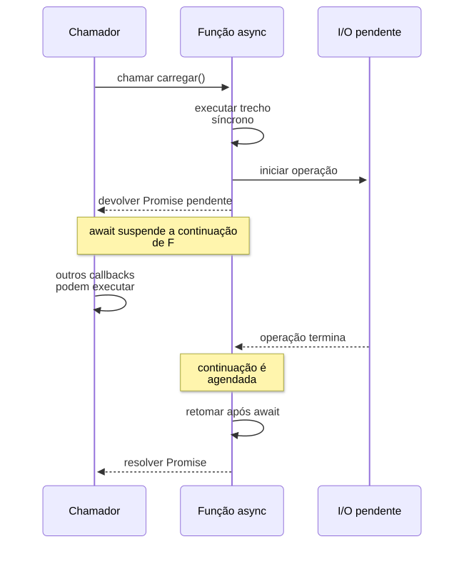

# 03 — Assincronismo e observabilidade

**Objetivo:** distinguir espera de bloqueio e medir o que realmente afeta a experiência do usuário.

## 1. Esperar uma operação não significa bloquear o event loop

Uma função `async` sempre devolve uma Promise. Seu código começa a executar normalmente e continua até encontrar uma suspensão, como um `await` de uma operação pendente.

**Complemento didático:** o exemplo abaixo introduz o comportamento de Promises e mostra a diferença entre suspender um fluxo e bloquear a thread.

```js
import { setTimeout as esperar } from 'node:timers/promises';

async function carregar() {
  console.log('2: começou');
  await esperar(20);
  console.log('4: retomou');
}

console.log('1: antes');
const tarefa = carregar();
console.log('3: a chamada já devolveu o controle');
await tarefa;
console.log('5: terminou');
```

`carregar()` só continua depois que o timer termina. Enquanto isso, a thread pode executar outros callbacks. O `await` faz aquele fluxo esperar, sem bloquear o processo inteiro.

Se você colocar um cálculo pesado antes do primeiro `await`, ele continuará rodando na thread atual. Envolver uma função em `Promise.resolve()` também não a transfere para outra thread. A distinção entre execução JavaScript e trabalho nativo está no guia [Don't Block the Event Loop](https://nodejs.org/en/learn/asynchronous-work/dont-block-the-event-loop).

<p align="center">
  <strong>Diagrama — O que acontece durante um await?</strong>
</p>

<p align="center">
  <a href="diagramas/svg/03-await.svg">
    
  </a>
</p>

<p align="center">
  <a href="diagramas/svg/03-await.svg">Ampliar SVG</a> · <a href="diagramas/03-await.mmd">Fonte (Mermaid)</a>
</p>

## 2. Três maneiras de posicionar trabalho em um fluxo

| Forma | Efeito na resposta | Limitação principal |
| --- | --- | --- |
| Aguardar com `await` | A resposta depende da conclusão da operação | A latência dessa operação entra no caminho crítico |
| Iniciar sem aguardar | A resposta pode prosseguir antes da conclusão | O trabalho continua disputando recursos e pode se perder com o processo |
| Publicar em fila persistente | A resposta pode depender apenas da aceitação do trabalho | É necessário acompanhar processamento, falhas e duplicidade |

A segunda forma é conhecida como *fire-and-forget* e a terceira como enfileiramento. Essa classificação é útil para entender latência, mas não substitui o desenho de confiabilidade.

**Fire-and-forget não significa outra thread.** O código síncrono inicial ainda executa na thread atual. O restante pode continuar depois, com consumo de CPU, memória, conexões e banda. Uma falha sem tratamento pode gerar uma rejeição não tratada.

Fragmento ilustrativo, com dependências fornecidas pela aplicação:

```js
// enviarMetrica e registrarFalha devem ser funções existentes.
// registrarFalha deve tratar a ocorrência sem lançar outra falha.
void Promise.resolve()
  .then(() => enviarMetrica({ evento: 'tela_aberta' }))
  .catch(registrarFalha);
```

Nesse trecho, o chamador segue sem esperar, e o `catch` trata uma possível rejeição. O trabalho não é salvo nem repetido automaticamente e pode se perder se o processo encerrar. Cobranças, envios obrigatórios e outros trabalhos que não podem sumir precisam de um mecanismo durável.

## 3. Concorrência, paralelismo e ordem

Concorrência é lidar com vários trabalhos em andamento no mesmo período. Paralelismo é executar trabalhos ao mesmo tempo em recursos diferentes. Um servidor pode atender muitas requisições de forma concorrente, executando um callback JavaScript por vez.

Se duas consultas são independentes, iniciá-las juntas pode reduzir o tempo total de espera:

```js
import { setTimeout as esperar } from 'node:timers/promises';

async function buscarPerfil() {
  await esperar(20);
  return { nome: 'Ana' };
}

async function buscarPreferencias() {
  await esperar(30);
  return { tema: 'escuro' };
}

const [perfil, preferencias] = await Promise.all([
  buscarPerfil(),
  buscarPreferencias(),
]);

console.log({ perfil, preferencias });
```

O timer simula espera; ele não representa cálculo paralelo. `Promise.all` rejeita quando uma das Promises rejeita e não cancela automaticamente as demais. Em listas grandes, limite a concorrência para não sobrecarregar o banco ou uma API externa.

Para CPU intensa, `worker_threads` permite executar JavaScript em paralelo. Criar um worker por tarefa pequena pode custar mais do que o trabalho; um pool costuma ser mais adequado. Veja os [casos de uso de workers](https://nodejs.org/api/worker_threads.html).

## 4. Observabilidade começa pelo fluxo de negócio

Para observar um fluxo, registre o tempo e o resultado da função que coordena o trabalho e das etapas importantes que ela chama. Por exemplo:

```text
processarPedido
    → validarEntrada
    → consultarEstoque
    → autorizarPagamento
    → salvarPedido
    → publicarNotificacao
```

Se o fluxo inteiro ficou lento, medir somente sua duração confirma o sintoma. Medir as etapas ajuda a localizar a causa. Em uma integração de voz, por exemplo, o tempo até a primeira resposta pode ser mais relevante que o tempo até concluir todo o processamento.

Três formas comuns de observar o sistema se complementam:

| Sinal | Pergunta que ajuda a responder |
| --- | --- |
| Logs | O que aconteceu em uma ocorrência específica? |
| Métricas | Com que frequência e intensidade isso acontece? |
| Traces | Qual caminho uma operação percorreu e onde gastou tempo? |

Você não precisa medir toda função auxiliar. Comece pelos fluxos críticos, pelas chamadas a dependências e pelos pontos de entrada e saída. Registre dados que ajudem a tomar decisões, com limites de volume para controlar o custo da coleta.

## 5. Medindo duração corretamente

Exemplo completo para estudo, com coleta em memória limitada a duas operações:

```js
import { performance } from 'node:perf_hooks';
import { setTimeout as esperar } from 'node:timers/promises';

const amostras = [];

async function medir(nome, executar) {
  const inicio = performance.now();
  let estado = 'sucesso';

  try {
    return await executar();
  } catch (erro) {
    estado = 'erro';
    throw erro;
  } finally {
    amostras.push({
      nome,
      estado,
      duracaoMs: performance.now() - inicio,
    });
  }
}

await medir('integracao.consultar', () => esperar(20));
await medir('pedido.salvar', () => esperar(10));
console.table(amostras);
```

`performance.now()` é apropriado para intervalos locais. Timestamp de calendário, como `Date.now()`, atende outras finalidades, como registrar quando um evento aconteceu. Consulte as [APIs de medição do Node.js](https://nodejs.org/api/perf_hooks.html).

O array serve para o estudo. Em produção, use um coletor que limite os dados em espera e controle o descarte. Se o envio das métricas falhar, preserve o resultado original da operação.

IDs de pedido ajudam em logs e traces. Em rótulos de métricas, porém, cada ID cria um valor diferente. Essa grande quantidade de valores é chamada de alta cardinalidade.

## 6. P50, P95 e P99

Percentil descreve uma posição na distribuição, não a média aritmética.

Se o P95 das durações é 500 ms, aproximadamente 95% das observações ficaram em até 500 ms e cerca de 5% acima, dependendo da convenção e das aproximações do cálculo. Isso descreve **observações**, não necessariamente 95% dos usuários: uma mesma pessoa pode gerar muitas chamadas.

P50 é a mediana. P95 e P99 ajudam a enxergar as respostas mais lentas, que podem ficar escondidas na média. Para interpretá-los, considere a quantidade de amostras, o período medido e quais rotas entraram no cálculo.

**Complemento didático:** acompanhar percentis por etapa não permite simplesmente somá-los para obter o percentil total. As observações lentas de cada etapa podem ocorrer em requisições diferentes. Meça também o fluxo completo.

## 7. Métricas que justificam ações

Uma boa tela de acompanhamento conecta sintoma e resposta:

| Sinal | Hipótese inicial | Investigação útil |
| --- | --- | --- |
| P99 alto e CPU alta | Trabalho computacional ou saturação | Profiler, event loop e tamanho das entradas |
| Integração externa mais lenta | Dependência degradada | Duração, timeouts e status do fornecedor |
| Fila crescendo | Entrada maior que a capacidade de consumo | Idade da mensagem mais antiga e workers ativos |
| Redis perto do limite | Acúmulo ou retenção excessiva | Backlog, retenção de jobs e política de memória |
| Erros após ativação de uma versão | Regressão possível | Comparar grupos, versão e flag |

Defina severidade, responsável e ação. Um alerta que apenas diz “algo deu errado” tende a gerar ruído. Para itens enfileirados, meça separadamente tempo de espera, processamento e tempo total até conclusão; uma API rápida pode esconder uma fila muito atrasada.

<p align="center">
  <strong>Diagrama — Da métrica à decisão de engenharia</strong>
</p>

<p align="center">
  <a href="diagramas/svg/03-metricas.svg">
    
  </a>
</p>

<p align="center">
  <a href="diagramas/svg/03-metricas.svg">Ampliar SVG</a> · <a href="diagramas/03-metricas.mmd">Fonte (Mermaid)</a>
</p>

## Revisão ativa

1. Por que deixar de usar `await` não torna um cálculo paralelo?
2. Quando publicar em fila é melhor que iniciar uma Promise sem aguardar?
3. Qual diferença entre medir aceitação de um job e conclusão do trabalho?
4. Por que P95 de requisições não equivale exatamente a P95 de usuários?

### Respostas esperadas

1. Retirar o `await` muda a espera do chamador, mas não transfere o cálculo para outra thread.
2. Quando o trabalho precisa ficar salvo e ser retomado mesmo se o processo encerrar.
3. A aceitação mede a publicação do job. A conclusão inclui a espera na fila e o processamento.
4. Uma pessoa pode gerar mais requisições que outra. O percentil das chamadas não corresponde diretamente ao percentil dos usuários.

Próximo: [Arquitetura modular e contratos](04-arquitetura-modular-e-contratos.md).
