# 04 — Arquitetura modular, camadas e contratos

**Objetivo:** separar responsabilidades sem criar abstrações que não ajudam o projeto.

## 1. A proposta de arquitetura modular

Arquitetura modular com camadas conhecidas é uma opção para equipes que precisam entregar rapidamente. A justificativa é reduzir o esforço para navegar, testar e alterar o código, mantendo limites de negócio claros.

Isso combina duas dimensões independentes:

- **Módulos:** agrupam capacidades de negócio, como pagamentos, usuários ou reservas.
- **Camadas:** separam responsabilidades técnicas dentro de cada módulo, como receber uma requisição, executar uma regra e persistir dados.

Exemplo de organização:

```text
src/
  modules/
    usuarios/
      usuarios.controller.ts
      usuarios.service.ts
      usuarios.repository.ts
      usuarios.schema.ts
      index.ts
      guidelines.md
    pagamentos/
      pagamentos.controller.ts
      pagamentos.service.ts
      pagamentos.repository.ts
      pagamentos.schema.ts
      index.ts
      guidelines.md
  shared/
    observabilidade/
  guidelines.md
```

Uma organização apenas por pastas globais, como `controllers/`, `services/` e `repositories/`, costuma espalhar uma mesma funcionalidade por muitos lugares. Agrupar por domínio pode reduzir essa dispersão.

Não é o nome da pasta que cria isolamento. Se qualquer módulo acessa diretamente tabelas e detalhes internos de outro, o acoplamento permanece.

## 2. Responsabilidades das camadas

| Camada | Faz | Evite concentrar nela |
| --- | --- | --- |
| Controller ou resolver | Converte protocolo e dados de entrada/saída | Regras centrais de negócio |
| Service ou caso de uso | Coordena decisões e operações do fluxo | Detalhes de HTTP e SQL espalhados |
| Repository | Executa o acesso à persistência | Decidir status HTTP e políticas de interface |
| Schema | Verifica o formato de dados em runtime | Substituir todas as regras de negócio |

Um schema pode garantir que `valorCentavos` seja um inteiro positivo. Saber se o usuário tem saldo, autorização ou limite disponível exige outras verificações.

DTO é um formato de transferência de dados; Zod é uma ferramenta de validação. Um DTO pode ter um schema associado, mas os termos não são sinônimos.

**Diagrama — Caminho de uma requisição**


[Ampliar SVG](diagramas/svg/04-camadas.svg) · [Fonte editável (Mermaid)](diagramas/04-camadas.mmd)

## 3. DI e DIP são conceitos diferentes

**Injeção de dependência (DI)** significa fornecer uma dependência ao componente que a utiliza, em vez de ele sempre construí-la internamente. Isso pode ser feito com funções comuns, sem classes e sem biblioteca.

**Inversão de dependência (DIP)** orienta a relação entre componentes: regras de nível mais alto dependem de contratos adequados, enquanto detalhes implementam esses contratos.

Exemplo completo em TypeScript:

```ts
type Usuario = { id: string; nome: string };

interface UsuariosRepository {
  buscarPorId(id: string): Promise<Usuario | null>;
}

function criarBuscarUsuario(repository: UsuariosRepository) {
  return async function buscarUsuario(id: string) {
    const usuario = await repository.buscarPorId(id);
    return usuario
      ? { ok: true as const, usuario }
      : { ok: false as const, erro: 'USUARIO_NAO_ENCONTRADO' as const };
  };
}

const dados: Usuario[] = [{ id: 'u1', nome: 'Ana' }];
const repositoryEmMemoria: UsuariosRepository = {
  async buscarPorId(id) {
    return dados.find((usuario) => usuario.id === id) ?? null;
  },
};

const buscarUsuario = criarBuscarUsuario(repositoryEmMemoria);
console.log(await buscarUsuario('u1'));
console.log(await buscarUsuario('u2'));
```

A função recebe a dependência: isso é DI. O contrato pedido pelo caso de uso não exige detalhes de uma ORM específica: isso exemplifica a intenção do DIP. A função `criarBuscarUsuario` também funciona como uma fábrica de comportamento configurado.

O contrato pode ser declarado com `interface` ou `type`. Não é necessário escrever `implements` em toda classe: a compatibilidade estrutural permite que um valor satisfaça o formato esperado. Veja o [Handbook de interfaces](https://www.typescriptlang.org/docs/handbook/interfaces.html).

**Diagrama — DI e DIP vistos separadamente**



[Ampliar SVG](diagramas/svg/04-di.svg) · [Fonte editável (Mermaid)](diagramas/04-di.mmd)

## 4. Tipos não existem em runtime, mas têm valor

Interfaces e anotações de tipos são removidas no processo de transformação para JavaScript. Isso impede usar apenas uma interface para verificar um JSON recebido pela rede. Não elimina sua função de checagem estática, documentação e apoio à refatoração. A documentação de [tipos apagados do TypeScript](https://www.typescriptlang.org/docs/handbook/2/basic-types.html#erased-types) explica essa distinção.

**Ajuste técnico:** a ausência da interface em runtime não torna DI ou DIP inúteis. Esses mecanismos também ajudam a explicitar dependências, variar configurações, testar componentes e substituir integrações. Sua utilidade depende do problema, não de o tipo ocupar memória durante a execução.

Criar uma interface idêntica para cada classe, sem necessidade de substituição ou isolamento, pode adicionar trabalho desnecessário. A alternativa é desenhar contratos pequenos em fronteiras relevantes.

## 5. Importação direta e mocks de módulo

Também é possível importar um repositório diretamente e substituí-lo em testes. Esse estilo pode reduzir configuração, especialmente em módulos pequenos.

Um fragmento desse desenho seria:

```ts
// Fragmento: o arquivo usuarios.repository.ts deve exportar buscarPorId.
import { buscarPorId } from './usuarios.repository.js';

export async function consultarUsuario(id: string) {
  return buscarPorId(id);
}
```

Para testá-lo isoladamente, o runner precisa oferecer uma forma compatível de substituir a dependência. O comportamento varia com ESM, CommonJS, carregamento e cache de módulos.

**Ajuste técnico:** um mock de módulo não deve ser entendido como uma aplicação obrigatória de `eval` nem como reescrita universal do código-fonte em runtime. O mecanismo depende da ferramenta. Mocks também podem esconder um acoplamento que dificultará outros usos.

| Pergunta | Importação direta | Dependência fornecida |
| --- | --- | --- |
| Existe configuração adicional? | Geralmente menor | Há um ponto de composição |
| A dependência está explícita no contrato? | Aparece nos imports | Aparece nos parâmetros |
| É fácil trocar por requisição ou teste? | Pode depender do runner | Pode receber outro objeto/função |
| É obrigatório usar classes? | Não | Não |

Escolha o desenho cujo custo seja proporcional ao problema. Simplicidade é reduzir o esforço total de evoluir o sistema, não apenas contar arquivos.

## 6. Limites entre módulos

O arquivo `index.ts` pode expor uma API pública do módulo. Outros módulos importam essa API, em vez de acessar livremente detalhes internos. Regras de lint, revisão e testes arquiteturais podem reforçar o limite quando necessário.

Ao separar um módulo em serviço, uma chamada local talvez precise virar HTTP ou mensagem. Essa mudança introduz latência, indisponibilidade parcial, autenticação, retries e consistência distribuída. Portanto, modularidade facilita uma extração, mas não a torna automática.

Uma regra que precisa de uma transação envolvendo várias tabelas merece atenção especial: mover metade dela para outro serviço muda as garantias do fluxo.

## 7. Como justificar a escolha

Uma resposta técnica convincente liga a decisão ao contexto:

> Para uma equipe pequena, começaria com um monólito modular. Cada módulo concentraria suas regras e usaria camadas simples. Isso reduz o custo de navegação e operação. Contratos seriam explícitos nas integrações e fronteiras que precisam de substituição. Separaria serviços quando houver um motivo concreto de escala, autonomia ou isolamento.

Essa é uma proposta argumentada, não uma regra universal. Arquiteturas hexagonal, clean, MVC e em camadas podem atender necessidades distintas e compartilhar vários princípios.

## Revisão ativa

1. Qual a diferença entre agrupar código por domínio e por camada?
2. É possível aplicar DI com uma função? Localize isso no exemplo.
3. Por que um tipo estático não valida automaticamente uma resposta HTTP?
4. Quais garantias mudam quando um import local vira uma chamada de rede?

**Respostas esperadas:** domínio aproxima uma funcionalidade e camada agrupa responsabilidades técnicas; o repositório é fornecido como argumento; tipos são apagados; a rede introduz falhas parciais e outras exigências de consistência e recuperação.

Próximo: [IA, contexto e tarefas](05-ia-contexto-guidelines-e-tarefas.md).
