# 05 — IA, contexto, guidelines e tarefas pequenas

**Objetivo:** transformar regras e rotinas de engenharia em contexto útil, tarefas verificáveis e ciclos de aprendizado.

## 1. A tese central: organizar o trabalho antes de automatizá-lo

Gerar código rapidamente não resolve, sozinho, a entrega de software. Ainda é preciso definir o problema, controlar dependências, verificar comportamento e observar os resultados depois da publicação.

A arquitetura modular ajuda porque aproxima código, regras e exemplos de um mesmo domínio. Uma tarefa de pagamentos pode começar pelos arquivos de pagamentos sem exigir a leitura de todos os módulos da empresa.

Isso reduz o contexto irrelevante, mas não garante acerto. Quando a tarefa atravessa módulos, precisa incluir os contratos e dependências pertinentes. Um recorte pequeno demais também pode esconder informação essencial.

## 2. Três tipos de documentação

Uma abordagem é separar memória/configuração, regras e procedimentos reutilizáveis:

| Documento | Função no projeto | Exemplo de conteúdo |
| --- | --- | --- |
| Arquivo de orientação ou memória | Localizar regras e registrar configurações recorrentes | Comandos de validação e caminho das guidelines |
| `guidelines.md` | Explicar convenções e regras de um escopo | Valores de pagamento em centavos; regras de autorização |
| Skill ou procedimento | Orientar uma tarefa repetível | Investigar latência, preparar uma tarefa ou revisar contrato |

`CLAUDE.md` e `AGENTS.md` são exemplos de arquivos usados por ferramentas; não existe uma semântica universal que torne ambos apenas memória. Carregamento, escopo e prioridade dependem do agente utilizado. `guidelines.md` também não é lido automaticamente por toda ferramenta.

O desenho útil é ter uma referência clara para a documentação pertinente e evitar repetir regras conflitantes em vários lugares.

## 3. Guidelines por domínio

Uma guideline deve expressar restrições concretas e observáveis. “Escreva código bom” não explica o que fazer; “represente os valores deste módulo em centavos inteiros” orienta uma decisão.

Exemplo de conteúdo para `src/modules/pagamentos/guidelines.md`:

```text
# Pagamentos — regras do domínio

- Valores monetários usam centavos inteiros e limites explícitos.
- Valide entradas na fronteira HTTP e nas integrações externas.
- Identifique eventos externos por provedor e ID de evento.
- Uma repetição do mesmo evento não pode duplicar o efeito financeiro.
- Registre duração, resultado e versão nos fluxos críticos.
- Não registre dados de cartão nem credenciais nos logs.
- Preserve a causa de falhas de integração para diagnóstico.
- Teste recusa de negócio, duplicidade e indisponibilidade do provedor.
```

Centavos evitam vários problemas de representação decimal, mas não dispensam limites, regras de arredondamento de taxas, tratamento de moedas e escolha do tipo numérico. Não transforme uma convenção local em regra para todo sistema.

Uma convenção possível é a precedência “subdomínio → domínio → global”. Isso pode ser uma convenção do projeto para regras locais compatíveis. Ela não permite ignorar instruções de prioridade superior, autorização do usuário ou requisitos que a ferramenta imponha. Uma regra de apresentação local, por exemplo, não substitui a política de acesso a dados da organização.

## 4. Skills como procedimentos parametrizados

A analogia com funções é útil: uma skill recebe uma intenção e dados, segue instruções e produz um resultado. Diferentemente de uma função pura, a execução por um modelo pode variar e envolver ferramentas, contexto incompleto e decisões.

Um procedimento precisa informar entrada, etapas e critério de conclusão. Exemplo didático em texto, sem depender do formato de uma plataforma específica:

```text
Procedimento: investigar regressão de latência

Entradas:
- Fluxo afetado e janela de tempo.
- Versões anterior e atual.
- P95/P99, taxa de erro e volume antes/depois.
- Links ou caminhos para os traces e o código relevante.

Etapas:
1. Confirmar que as amostras são comparáveis.
2. Identificar a etapa cujo tempo mudou.
3. Formular uma hipótese e indicar evidências que a contradiriam.
4. Propor a menor alteração coerente com a hipótese.
5. Validar comportamento e comparar as métricas.

Saída:
- Evidências, hipótese, mudança, validação e dúvidas restantes.
```

Parâmetros estáveis podem ser registrados em configuração, como caminho de logs e comando de teste. Segredos não devem ser copiados para arquivos de instrução. Perguntar novamente algo que já está definido aumenta atrito; presumir um dado crítico que está ausente aumenta risco de erro.

## 5. Uma tarefa boa limita o problema e define sucesso

*Entry points* são os arquivos por onde começar a investigação. Eles são pontos de entrada, não uma proibição de consultar outras dependências quando o raciocínio exigir.

Exemplo de tarefa:

```text
Título: rejeitar eventos de pagamento com valor inválido

Problema:
O endpoint aceita valorCentavos negativo e encaminha o evento ao serviço.

Resultado esperado:
Rejeitar entradas inválidas antes de iniciar a persistência.

Pontos de entrada:
- src/modules/pagamentos/pagamentos.schema.ts
- src/modules/pagamentos/pagamentos.controller.ts
- src/modules/pagamentos/guidelines.md

Critérios de aceitação:
- Zero, negativos e valores não inteiros recebem resposta de entrada inválida.
- Um valor válido continua seguindo o fluxo existente.
- Uma entrada rejeitada não altera o banco nem publica mensagens.

Validação:
- Exercitar a fronteira HTTP e conferir a ausência de efeitos colaterais.

Observabilidade:
- Contar rejeições por motivo sem copiar o payload sensível.

Dependências:
- Nenhuma migração de banco é necessária.
```

A tarefa é pequena porque tem um comportamento delimitado. Dividir uma alteração em muitos cards sem independência real não melhora automaticamente o processo. Mudanças de contrato, migrações e ordenação de deploy precisam estar explícitas.

## 6. Planejar, executar, revisar e observar

O fluxo proposto pode ser organizado assim:

```text
Dor de produto
    → critérios e divisão em tarefas
    → implementação com contexto do módulo
    → validação automatizada
    → revisão de código e de comportamento
    → publicação gradual
    → observação dos resultados
    → ajuste do produto ou da implementação
```

Revisão humana entre etapas e revisões especializadas ajudam a verificar temas como segurança, desempenho e testes. Isso evita concentrar toda a análise em um pedido amplo demais.

Cada revisão deve produzir achados concretos, localização e consequência. Comentários genéricos não substituem evidência. Uma revisão de desempenho, por exemplo, deve indicar o caminho afetado e a medição necessária, não apenas sugerir “otimizar”.

A integração com sistemas de tarefas, repositórios e canais de comunicação via ferramentas/MCP permite automatizar partes do fluxo: ler, escrever e enviar mensagens dependem das permissões e do escopo autorizado em cada ambiente.

<p align="center">
  <strong>Diagrama — Do problema de produto ao aprendizado</strong>
</p>

<p align="center">
  <a href="diagramas/svg/05-ciclo.svg">
    
  </a>
</p>

<p align="center">
  <a href="diagramas/svg/05-ciclo.svg">Ampliar SVG</a> · <a href="diagramas/05-ciclo.mmd">Fonte (Mermaid)</a>
</p>

## 7. Contexto e custo

Uma janela de contexto grande não garante que todas as informações receberão a mesma atenção. A expressão *lost in the middle* descreve a dificuldade de localizar informações importantes em material extenso.

Medidas práticas incluem manter documentação curta, aproximar regras do código, indicar pontos de entrada e remover instruções obsoletas. Não é necessário copiar a codebase inteira em cada pedido.

É possível combinar modelos para planejar, implementar e revisar. Escolha ferramentas pelo resultado observado na tarefa, custo, tempo e qualidade das verificações, em vez de memorizar um ranking.

## 8. Indicadores de um fluxo saudável

Número de PRs e linhas geradas mostram atividade, mas não medem isoladamente valor entregue. Acompanhe também tempo até uma mudança útil chegar ao usuário, defeitos, retrabalho, incidentes e recuperação.

Cycle time é o tempo entre pontos definidos do fluxo, por exemplo, início da implementação e conclusão. O valor só pode ser comparado quando os pontos de início e fim são consistentes. Uma duração desejável depende do contexto da equipe e não constitui um padrão obrigatório de mercado.

## Revisão ativa

- Qual informação pertence a uma guideline de domínio e qual pertence à tarefa?
- Como escrever um critério de aceitação que possa ser verificado?
- Quando reduzir contexto passa a esconder informação necessária?
- O que você verificaria antes de concluir que a IA melhorou a entrega da equipe?

**Respostas esperadas:** regras recorrentes ficam próximas do domínio e resultados específicos ficam na tarefa; descreva comportamento observável; inclua dependências que alteram a decisão; compare qualidade, fluxo, retrabalho e resultados, além de velocidade.

Próximo: [Testes e entrega gradual](06-testes-feature-flags-e-entrega.md).
