# 07 — Infraestrutura Node.js: de processos a containers

**Objetivo:** escolher um modelo de execução pelo comportamento da carga e pela capacidade operacional da equipe.

## 1. Quanto controle a equipe precisa?

Em um serviço gerenciado, o provedor cuida de parte da operação. A equipe ainda configura e acompanha o serviço. Administrar mais partes da infraestrutura dá flexibilidade, mas exige tempo, conhecimento e manutenção.

Preservar tempo para o produto é um critério relevante em empresas pequenas. Isso não significa que todo serviço gerenciado seja barato no início e caro depois: o custo depende de utilização, tráfego, disponibilidade, armazenamento e esforço humano.

| Modelo | O que a equipe administra principalmente | Situação em que merece avaliação |
| --- | --- | --- |
| Plataforma de aplicação, como Vercel | Aplicação e configuração da plataforma | Produto web e protótipos com entrega rápida |
| EC2 com gerenciador de processos | Máquina, sistema operacional e aplicação | Necessidade de controle sobre uma VM |
| Lambda | Função, gatilhos, permissões e limites | Processamento por evento e tarefas delimitadas |
| ECS com Fargate | Containers, serviços, rede e políticas de escala | APIs e workers em containers sem administrar os hosts |
| EKS/Kubernetes | Aplicação e uma plataforma operacional mais ampla | Necessidades que justifiquem sua complexidade |

Você pode combinar esses modelos conforme a necessidade. Não é preciso passar por todos eles em uma ordem fixa.

## 2. EC2 e PM2

EC2 oferece máquinas virtuais configuráveis. PM2 é um gerenciador de processos que pode iniciar, monitorar e reiniciar aplicações Node.js. No modo cluster, distribui conexões entre processos da aplicação.

Exemplo de configuração `ecosystem.config.cjs`, supondo que a aplicação exponha um servidor em `dist/server.js`:

```js
module.exports = {
  apps: [{
    name: 'api',
    script: './dist/server.js',
    exec_mode: 'cluster',
    instances: 2,
    max_memory_restart: '512M',
    env: { NODE_ENV: 'production' },
  }],
};
```

Cada processo tem seu próprio heap. Um `Map` criado em um processo não é compartilhado automaticamente com os outros. Sessões, locks e dados que precisam de coordenação devem usar um mecanismo apropriado. O [modo cluster do PM2](https://pm2.keymetrics.io/docs/usage/cluster-mode/) também exige atenção ao encerramento e à ausência de estado local indispensável.

O reinício automático ajuda a recuperar a aplicação. Ainda assim, requisições em andamento podem falhar. Se todos os processos estão na mesma VM, a perda dessa máquina afeta todos eles.

## 3. Serverless e stateless não são sinônimos

Em serverless, o provedor administra os servidores para você. Já uma instância stateless não precisa guardar localmente o estado do negócio entre atendimentos para o sistema funcionar corretamente.

Um processo stateless pode manter conexões e caches em memória para eficiência. A correção não pode depender de ele sobreviver, nem de uma próxima chamada chegar à mesma instância.

Uma função Lambda pode reutilizar um ambiente já inicializado, com suas variáveis de módulo e conexões. Mas o provedor pode descartar esse ambiente ou criar outro. Aproveite a reutilização quando ela ocorrer, sem depender dela para o código funcionar. Veja o [ciclo de vida do ambiente Lambda](https://docs.aws.amazon.com/lambda/latest/dg/lambda-runtime-environment.html).

## 4. Lambda: evento entra, execução acontece

Rotinas agendadas e consumidores de fila são exemplos de uso de Lambda. Um evento aciona a função, que processa uma unidade ou lote de trabalho e devolve um resultado.

No modelo tradicional de Lambda, uma invocação possui duração máxima configurável de até **15 minutos**. A AWS possui modalidades e recursos com limites diferentes; confirme a modalidade e as [quotas de Lambda](https://docs.aws.amazon.com/lambda/latest/dg/gettingstarted-limits.html) antes de dimensionar a carga.

### Cold start e aquecimento

Cold start é o custo de inicializar um ambiente para atender uma execução. Pacote, inicialização, runtime e dependências influenciam esse tempo. Não existe uma duração fixa de 30 ou 40 segundos para todas as funções.

Enviar chamadas periódicas pode estimular reutilização, mas não assegura que todas as instâncias necessárias para um pico já existam. Recursos de concorrência provisionada atendem a outro nível de controle, com custo próprio. O importante é comparar a latência exigida com o comportamento real do ambiente.

### O banco não escala na mesma proporção automaticamente

Se muitas funções começarem a executar ao mesmo tempo, elas podem abrir conexões demais com o banco. Calcule o limite considerando quantas funções executam juntas, o tamanho de cada pool e uma margem de segurança. Além da CPU, acompanhe conexões ativas, espera por uma conexão livre, locks e tempo das consultas.

Proxies e poolers, como PgBouncer em cenários PostgreSQL, podem ajudar, mas precisam ser compatíveis com as transações e o modo de uso da aplicação. Limitar a concorrência do consumidor também protege dependências.

Serverless Framework e SST são ferramentas de desenvolvimento e infraestrutura. A fidelidade entre desenvolvimento local e cloud depende de versão, plugins e modo de execução; emulação local não substitui validar a integração no ambiente pertinente.

## 5. ECS com Fargate

ECS organiza tarefas e serviços de containers. Fargate fornece a capacidade para executá-los sem administrar as máquinas hospedeiras diretamente. Essa separação é descrita na [documentação de Fargate para ECS](https://docs.aws.amazon.com/AmazonECS/latest/developerguide/AWS_Fargate.html).

Essa combinação pode atender APIs e workers que precisam de processos de longa duração. É possível manter réplicas ativas e configurar escalabilidade por métricas, em vez de depender de uma invocação curta por evento.

**Ajuste técnico:** não ter o mesmo timeout de uma invocação Lambda não significa executar eternamente. Containers podem ser substituídos durante deploy, manutenção e falhas. Estado durável deve ficar fora da instância, e operações em andamento precisam lidar com interrupção.

O aumento automático de capacidade, ou autoscaling, também precisa ser configurado. Para um worker, a idade das mensagens ou a quantidade de trabalho pendente pode indicar melhor a demanda que a CPU. Antes de aumentar as réplicas, confira se o banco e os fornecedores suportam mais acessos simultâneos.

## 6. EKS e Kubernetes

Kubernetes é uma plataforma para orquestrar containers; EKS é uma oferta gerenciada da AWS para esse ecossistema. Recursos de automação, distribuição e extensibilidade podem ser úteis, mas também exigem conhecimentos de rede, implantação, observação e capacidade.

Adie essa complexidade quando a equipe não consegue operá-la. Compare o benefício com o custo operacional total. Não existe uma obrigação universal de ter um cargo específico de SRE, nem garantia de economia depois da migração.

<p align="center">
  <strong>Diagrama — Da necessidade ao modelo de execução</strong>
</p>

<p align="center">
  <a href="diagramas/svg/07-infra.svg">
    
  </a>
</p>

<p align="center">
  <em>Árvore de avaliação didática: as opções podem se combinar e dependem da carga e da equipe.</em>
</p>

<p align="center">
  <a href="diagramas/svg/07-infra.svg">Ampliar SVG</a> · <a href="diagramas/07-infra.mmd">Fonte (Mermaid)</a>
</p>

## 7. Perguntas antes de escolher

1. A carga é uma API, um job limitado ou um processo longo?
2. A latência de inicialização cabe no objetivo do produto?
3. Onde o estado durável fica armazenado?
4. Como o sistema reage quando uma instância desaparece?
5. Qual dependência limita a concorrência?
6. Quem configura, monitora e recupera a infraestrutura?
7. O custo foi estimado para o volume real, incluindo operação?

**Exercício:** para receber um webhook, responder rapidamente e processar depois, compare uma função que publica em fila com uma API em container que faz o mesmo. A decisão não deve depender apenas do nome do serviço: considere confirmação de aceitação, picos, idempotência e tempo de recuperação.

Próximo: [Filas, BullMQ, SQS e outbox](08-filas-bullmq-sqs-e-outbox.md).
