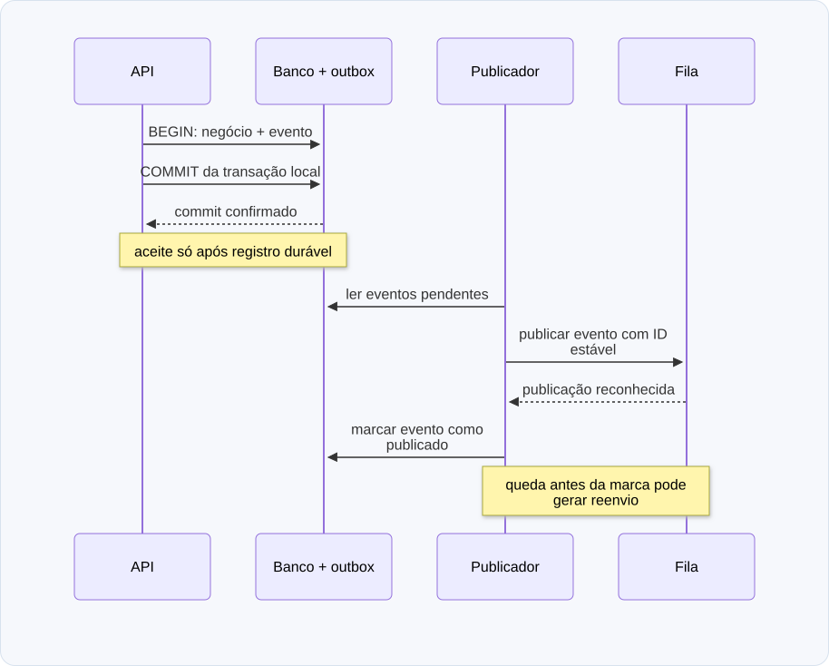

# 08 — Filas, BullMQ, SQS e publicação confiável

**Objetivo:** entender o que uma fila resolve e quais garantias continuam sendo responsabilidade da aplicação.

## 1. Separar aceitação de processamento

Uma fila permite que quem recebe o pedido não precise executar todo o trabalho imediatamente. Um consumidor pode retomar o processamento depois e ajustar a capacidade de consumo de forma independente.

```text
Cliente → API → fila → worker → banco / integração
               aceite       execução e resultado
```

Se a API confirma que aceitou o trabalho, precisa saber o que essa confirmação significa. Responder antes de a publicação ter sido reconhecida pode levar o cliente a acreditar que algo foi aceito sem haver registro durável.

Uma fila absorve variações temporárias de demanda. Se a entrada permanecer maior que a capacidade de processamento, o backlog continuará crescendo. Ela não cria capacidade infinita.

## 2. Fila e pub/sub têm efeitos diferentes

| Modelo | Intenção | Exemplo |
| --- | --- | --- |
| Fila de trabalho com consumidores concorrentes | Distribuir jobs entre consumidores | Vários workers disputam envios de e-mail |
| Pub/sub | Distribuir um evento a assinantes interessados | Pagamento aprovado interessa a faturamento e notificações |

Para que cada serviço receba sua própria cópia, um desenho possível é um tópico SNS com filas SQS distintas por assinatura. Colocar dois serviços consumindo a mesma fila de trabalho geralmente distribui as mensagens entre eles; não garante entregar todas a ambos.

Nem todo mecanismo chamado pub/sub é persistente. A durabilidade depende da tecnologia e de sua configuração.

<p align="center">
  <strong>Diagrama — Fila de trabalho e distribuição para assinantes</strong>
</p>

<p align="center">
  <a href="diagramas/svg/08-fanout.svg">
    
  </a>
</p>

<p align="center">
  <a href="diagramas/svg/08-fanout.svg">Ampliar SVG</a> · <a href="diagramas/08-fanout.mmd">Fonte (Mermaid)</a>
</p>

## 3. BullMQ: jobs armazenados em Redis

BullMQ organiza jobs, workers, tentativas e estados sobre Redis. É possível usar tanto instalações pequenas, com componentes na mesma máquina, quanto uma API, um Redis e um serviço de processamento separados.

Separar componentes reduz disputas e falhas compartilhadas. Quando API, fila e worker estão na mesma máquina, perder essa máquina pode afetar todos ao mesmo tempo.

Exemplo de produtor e consumidor. Dependência: `npm install bullmq`. É necessário um Redis acessível em `127.0.0.1:6379`; o processo permanece ativo para consumir jobs:

```js
import { Queue, Worker } from 'bullmq';

const connection = { host: '127.0.0.1', port: 6379 };
const fila = new Queue('notificacoes', { connection });

const worker = new Worker('notificacoes', async (job) => {
  // Simulação: uma integração real precisa ser idempotente.
  console.log('Processando:', job.id, job.data.pedidoId);
}, { connection, concurrency: 4 });

worker.on('error', (erro) => console.error('Erro do worker:', erro));
worker.on('failed', (job, erro) => {
  console.error('Job falhou:', job?.id, erro.message);
});

await fila.add('pedido-criado', { pedidoId: 'p1' }, {
  jobId: 'pedido-p1',
  attempts: 3,
  backoff: { type: 'exponential', delay: 1_000 },
  removeOnComplete: { count: 100 },
  removeOnFail: { count: 1_000 },
});

process.once('SIGINT', () => {
  void (async () => {
    await worker.close();
    await fila.close();
  })().catch((erro) => {
    console.error(erro);
    process.exitCode = 1;
  });
});
```

Esse snippet apenas demonstra o mecanismo. Não configura alta disponibilidade ou persistência. Um `jobId` pode ajudar a evitar repetição enquanto o registro do job existe, mas não substitui a idempotência do efeito de negócio: depois de removido, o mesmo ID pode voltar a ser aceito.

### Por que memória e política de descarte importam?

Se os consumidores param, os jobs pendentes continuam ocupando espaço. Isso é acúmulo de trabalho, não necessariamente um vazamento de memória: os dados estão sendo retidos intencionalmente.

Redis usado como cache pode descartar chaves, mas esse comportamento não é aceitável para estruturas internas de uma fila. BullMQ recomenda `maxmemory-policy=noeviction`, além de configurar persistência e recuperação conforme a tolerância a perda. Consulte [Going to production](https://docs.bullmq.io/guide/going-to-production).

A compatibilidade precisa ser verificada para a oferta e versão exatas. Na documentação consultada, BullMQ recomenda ElastiCache baseado em nós e aponta incompatibilidade com a política de memória da oferta serverless. Isso é uma restrição específica, não prova que todo Redis com algum autoscaling seja incompatível. Veja [BullMQ com AWS ElastiCache](https://docs.bullmq.io/guide/redis-tm-hosting/aws-elasticache).

## 4. SQS: serviço gerenciado de filas

SQS reduz a operação direta do armazenamento da fila. A aplicação ainda precisa tratar retenção, duplicidade, tempo de visibilidade, falhas de publicação e limites de consumo.

Em filas Standard, mensagens podem ser entregues mais de uma vez e fora de ordem. A [documentação de entrega do SQS](https://docs.aws.amazon.com/AWSSimpleQueueService/latest/SQSDeveloperGuide/standard-queues-at-least-once-delivery.html) recomenda consumidores idempotentes.

Quando um consumidor recebe uma mensagem, ela fica temporariamente invisível. Se ele falhar antes de confirmar a conclusão, a mensagem pode ficar disponível novamente. Se o trabalho demora além do período configurado, pode haver processamento concorrente da mesma mensagem.

Na integração com Lambda, o mapeamento de eventos faz a leitura e administra o processamento em lotes. Falhas parciais precisam ser reportadas adequadamente para reduzir reprocessamento de itens já concluídos. Veja [Lambda com SQS](https://docs.aws.amazon.com/lambda/latest/dg/with-sqs.html).

### DLQ e retries

Uma *dead-letter queue* concentra mensagens que não puderam ser processadas segundo a política configurada. Ela precisa de acompanhamento, diagnóstico e um procedimento de reprocessamento. Transferir a mensagem para uma DLQ não conclui o objetivo do negócio.

Retries devem diferenciar falhas transitórias, como um timeout, de entradas definitivamente inválidas. Espera progressiva entre tentativas evita insistir imediatamente em uma dependência já saturada.

## 5. Idempotência: repetir sem duplicar o efeito

O problema central aparece quando o efeito acontece, mas a confirmação se perde. Se uma cobrança foi aceita pelo provedor e o worker caiu antes de registrar a conclusão, a próxima tentativa não pode simplesmente cobrar de novo.

Uma estratégia pode combinar uma chave estável da operação, uma restrição de unicidade local e idempotência no provedor. “Consultar se existe e depois inserir” em duas operações independentes não garante exclusão mútua sob concorrência.

**Complemento didático:** para um efeito inteiramente no mesmo PostgreSQL, uma transação pode registrar o evento e aplicar a mudança de forma atômica. O fragmento abaixo pressupõe `eventos_processados(evento_id PRIMARY KEY)` e `contas(id PRIMARY KEY, saldo_centavos)`:

```sql
BEGIN;

WITH novo_evento AS (
  INSERT INTO eventos_processados (evento_id)
  VALUES ($1)
  ON CONFLICT (evento_id) DO NOTHING
  RETURNING evento_id
)
UPDATE contas
SET saldo_centavos = saldo_centavos + $2
WHERE id = $3
  AND EXISTS (SELECT 1 FROM novo_evento);

-- O chamador deve exigir que a conta exista e conferir o resultado.
-- Se faltar a conta na primeira tentativa, desfaz a transação.
COMMIT;
```

Os parâmetros são fornecidos pelo cliente SQL. Uma repetição não reaplica o crédito. Para uma API externa, essa transação não engloba o efeito remoto: é necessário um protocolo adicional e reconciliação de resultados incertos.

<p align="center">
  <strong>Diagrama — Repetir o trabalho sem duplicar o efeito</strong>
</p>

<p align="center">
  <a href="diagramas/svg/08-worker.svg">
    
  </a>
</p>

<p align="center">
  <a href="diagramas/svg/08-worker.svg">Ampliar SVG</a> · <a href="diagramas/08-worker.mmd">Fonte (Mermaid)</a>
</p>

## 6. Outbox resolve a escrita dupla

O padrão outbox transacional resolve a necessidade de alterar o banco e publicar um evento sem deixar uma dessas operações esquecida. Ele não se resume a salvar dados em outro lugar quando Redis falha.

Sem outbox, pode acontecer:

```text
Salvar pedido no banco → processo cai → evento nunca publicado
```

Com outbox:

```text
Uma transação salva o pedido e um registro de evento na outbox.
Um publicador lê a outbox, publica e marca o registro como enviado.
```

Fragmento SQL, supondo tabelas `pedidos` e `outbox` existentes e parâmetros válidos:

```sql
BEGIN;

INSERT INTO pedidos (id, valor_centavos) VALUES ($1, $2);

INSERT INTO outbox (id, tipo, agregado_id, payload, publicado_em)
VALUES ($3, 'PedidoCriado', $1, $4::jsonb, NULL);

COMMIT;
```

Se o publicador cair depois de publicar e antes de marcar o registro, ele pode publicar de novo. Outbox, portanto, exige consumidores preparados para duplicatas e não garante “exatamente uma vez” de ponta a ponta. O publicador também precisa coordenar concorrência, tentativas, retenção e observabilidade. Veja o [padrão transactional outbox da AWS](https://docs.aws.amazon.com/prescriptive-guidance/latest/cloud-design-patterns/transactional-outbox.html).

<p align="center">
  <strong>Diagrama — Outbox: resolver a escrita dupla</strong>
</p>

<p align="center">
  <a href="diagramas/svg/08-outbox.svg">
    
  </a>
</p>

<p align="center">
  <a href="diagramas/svg/08-outbox.svg">Ampliar SVG</a> · <a href="diagramas/08-outbox.mmd">Fonte (Mermaid)</a>
</p>

## 7. Blast radius e sinais de operação

Blast radius é o alcance de uma falha. Várias filas compartilhando o mesmo Redis e seus limites podem afetar umas às outras. Separar armazenamento ou capacidade por domínio pode reduzir esse risco.

Ter filas SQS separadas também não elimina todo risco compartilhado: conta, permissões, região, banco e consumidores podem continuar comuns.

Observe backlog, idade da mensagem mais antiga, taxa de entrada e saída, tentativas, erros, DLQ e disponibilidade dos consumidores. No Redis, acompanhe memória e política de retenção dos jobs concluídos. Idade crescente costuma mostrar um atraso de negócio que a latência da API não revela.

RabbitMQ e Kafka são outras tecnologias de mensageria a considerar. A escolha não depende só de TPS: roteamento, retenção, replay, ordem e modelo de consumo precisam ser comparados. Não existe um patamar universal que obrigue migrar de BullMQ para SQS ou Kafka.

## Revisão ativa

1. O que acontece se o worker concluir o efeito e cair antes de confirmar a mensagem?
2. Por que dois serviços na mesma fila não recebem necessariamente os mesmos eventos?
3. Qual diferença entre backlog, vazamento e descarte de chaves?
4. Qual falha o outbox evita e qual duplicidade ainda pode ocorrer?

**Respostas esperadas:** pode haver repetição e ela precisa ser segura; consumidores concorrentes distribuem jobs; backlog é trabalho retido, vazamento é retenção indevida e descarte pode perder dados; outbox evita esquecer a publicação após o commit, mas o publicador pode reenviar.

Próximo: [Bancos de dados e escala](09-bancos-de-dados-e-escalabilidade.md).
