# 09 — Bancos de dados, consistência e escala

**Objetivo:** escolher o armazenamento pelos acessos e garantias exigidos, e reconhecer o gargalo antes de distribuir dados.

<p align="center">
  <strong>Diagrama — Escolher pelo padrão de acesso</strong>
</p>

<p align="center">
  <a href="diagramas/svg/09-banco.svg">
    
  </a>
</p>

<p align="center">
  <a href="diagramas/svg/09-banco.svg">Ampliar SVG</a> · <a href="diagramas/09-banco.mmd">Fonte editável (Mermaid)</a>
</p>

## 1. O banco costuma limitar a escala do restante

Aumentar o número de APIs e workers pode aumentar a pressão sobre o mesmo banco. Mais concorrência não cria mais capacidade de escrita, de conexão ou de atendimento a consultas automaticamente.

Antes de migrar de tecnologia, investigue consultas lentas, índices, volume transferido, transações longas, locks, pools e recursos da máquina. Um banco com CPU baixa também pode estar sofrendo com espera por I/O ou bloqueios.

Número de usuários e faturamento não determinam diretamente a carga. Um pequeno grupo executando relatórios complexos pode gerar mais pressão que muitos usuários com acessos simples.

## 2. RDS e Aurora

RDS é um serviço gerenciado para bancos relacionais. Aurora é uma família de bancos compatíveis com **MySQL ou PostgreSQL**, integrada ao ecossistema RDS. Não é uma versão Aurora MariaDB. Veja [What is Amazon Aurora?](https://docs.aws.amazon.com/AmazonRDS/latest/AuroraUserGuide/CHAP_AuroraOverview.html).

Gerenciamento de backup e infraestrutura não elimina a responsabilidade de modelar dados e otimizar consultas. Aurora pode reduzir trabalho operacional em alguns cenários; a adequação depende de recursos necessários e custo real.

### Multi-AZ não significa vários países

Uma região AWS contém zonas de disponibilidade distintas. Uma implantação Multi-AZ distribui recursos entre zonas de uma região; replicação entre regiões é outra configuração. Veja [Regions and Availability Zones](https://docs.aws.amazon.com/AmazonRDS/latest/AuroraUserGuide/Concepts.RegionsAndAvailabilityZones.html).

### Réplicas, escala vertical e sharding

| Técnica | O que altera | Principal limite |
| --- | --- | --- |
| Escala vertical | Capacidade de uma máquina/instância | Custo e limite de tamanho |
| Réplicas de leitura | Destinos para consultas | Não distribuem automaticamente as escritas |
| Particionamento de tabela | Organização de partes de uma tabela | Só ajuda consultas e manutenção compatíveis com a divisão |
| Sharding | Distribuição dos dados entre nós | Roteamento, reequilíbrio, joins e transações distribuídas |

Uma réplica pode apresentar atraso em relação à escrita. Se uma tela precisa ler imediatamente o resultado de uma alteração, defina como atender a consistência necessária. “Todos os bancos são eventualmente consistentes” é uma generalização incorreta: a garantia depende da operação e da configuração.

## 3. Índices e plano de consulta

Um índice é uma estrutura adicional para localizar dados sem percorrer tudo em cada acesso. Ele também custa armazenamento e trabalho nas escritas. Criar índices para toda combinação imaginável de filtros pode prejudicar a operação.

**Complemento didático:** em uma listagem por empresa ordenada por data, um índice composto pode acompanhar a consulta. O fragmento pressupõe `transacoes(empresa_id, criado_em, id, status, valor_centavos)`:

```sql
CREATE INDEX idx_transacoes_empresa_data_id
ON transacoes (empresa_id, criado_em DESC, id DESC);

SELECT id, status, valor_centavos, criado_em
FROM transacoes
WHERE empresa_id = $1
  AND (criado_em, id) < ($2, $3)
ORDER BY criado_em DESC, id DESC
LIMIT 50;
```

Os parâmetros de cursor são a data e o ID do último item da página anterior. Para a primeira página, omita a condição do cursor. O segundo campo de ordenação torna determinística a posição quando duas transações têm a mesma data.

Avalie o índice no plano de execução e com dados representativos. Um scan pode ser uma boa escolha quando grande parte da tabela é necessária; não é automaticamente um erro. Consulte [Using EXPLAIN](https://www.postgresql.org/docs/current/using-explain.html) e a [documentação de índices](https://www.postgresql.org/docs/current/indexes.html).

`EXPLAIN ANALYZE` realmente executa a instrução. Use-o de forma compatível com o ambiente e com os efeitos da consulta, especialmente para escritas.

## 4. Escrita em lote

Agrupar eventos de webhook pode reduzir o custo de gravar um a um. Um lote pode reduzir viagens de rede e custo por comando ou transação. Isso não significa comprimir todos os eventos em uma única linha.

Exemplo de inserção de vários eventos, supondo uma chave única em `evento_id`:

```sql
INSERT INTO eventos (evento_id, tipo, criado_em)
VALUES
  ($1, $2, $3),
  ($4, $5, $6),
  ($7, $8, $9)
ON CONFLICT (evento_id) DO NOTHING;
```

O chamador fornece os parâmetros e precisa decidir como acompanhar os itens já existentes, inválidos ou rejeitados. Se o lote causa outros efeitos, ignorar conflitos não torna todo o fluxo idempotente por si só.

Um agrupador de produção deve descarregar o lote ao atingir **um tamanho ou um tempo máximo**, o que acontecer primeiro. Esperar sempre 500 itens pode atrasar indefinidamente um fluxo com baixo volume. Também é preciso persistir o trabalho pendente e definir a confirmação das mensagens.

**Ajuste técnico:** cada insert não gera necessariamente um arquivo de binlog. O binary log contém eventos de alterações e transações, de acordo com o formato e a configuração. Lotes podem melhorar desempenho, mas o benefício não vem de uma regra “um registro = um binlog”. Veja o [manual do binary log do MySQL](https://dev.mysql.com/doc/refman/8.4/en/binary-log.html).

<p align="center">
  <strong>Diagrama — Escrever em lote sem esperar indefinidamente</strong>
</p>

<p align="center">
  <a href="diagramas/svg/09-lote.svg">
    
  </a>
</p>

<p align="center">
  <a href="diagramas/svg/09-lote.svg">Ampliar SVG</a> · <a href="diagramas/09-lote.mmd">Fonte editável (Mermaid)</a>
</p>

## 5. MongoDB e modelagem de documentos

MongoDB oferece um modelo flexível e uma oferta gerenciada, Atlas. O formato de documento pode ser conveniente quando os dados são lidos e alterados como um agregado.

Flexibilidade de esquema não significa ausência de modelagem. É preciso escolher o que incorporar, o que referenciar, como indexar e quais invariantes manter. NoSQL também não significa consistência automaticamente superior ou sharding sem dificuldades.

Usar MongoDB em projetos simples ou como banco auxiliar é uma escolha contextual. Um projeto pequeno pode usar banco relacional; um sistema grande pode usar documentos. A decisão deve partir das consultas, transações, garantias e conhecimento da equipe.

## 6. DynamoDB: desenhar a partir do acesso

DynamoDB pode servir como armazenamento auxiliar para eventos, histórico recente e chaves de controle. A ideia é retirar do banco principal certos acessos que possuem um padrão conhecido.

O desenho precisa começar pelas perguntas de acesso: “buscar eventos desta conversa em um intervalo” é diferente de “filtrar todas as transações por critérios arbitrários”. Chaves e índices alinhados a essas perguntas evitam scans desnecessários.

Uma operação `Query` é paginada; a AWS documenta páginas de até 1 MB e continuação por `LastEvaluatedKey`. Esse limite não é o tamanho máximo de toda a base nem uma razão para ignorar paginação. Veja [Query pagination](https://docs.aws.amazon.com/amazondynamodb/latest/developerguide/Query.Pagination.html).

### TTL: expiração lógica e remoção física

TTL significa **Time to Live**. No DynamoDB, o atributo de expiração usa timestamp Unix em segundos. A remoção automática de itens expirados é assíncrona e pode ocorrer dias depois; portanto, um item ainda existir não significa que sua janela de negócio permaneça válida. Consulte [Using TTL in DynamoDB](https://docs.aws.amazon.com/amazondynamodb/latest/developerguide/TTL.html).

Exemplo completo, apenas para calcular e interpretar a expiração:

```js
const agoraSegundos = Math.floor(Date.now() / 1_000);

const registro = {
  pk: 'limite#usuario-1',
  contador: 5,
  expiresAt: agoraSegundos + 30 * 60,
};

function estaVigente(item, instanteSegundos) {
  return item !== undefined && item.expiresAt > instanteSegundos;
}

console.log(estaVigente(registro, agoraSegundos));          // true
console.log(estaVigente(registro, agoraSegundos + 30 * 60)); // false
```

Para um bloqueio de 30 minutos, a aplicação precisa interpretar o timestamp. O TTL cuida de limpeza posterior, sem funcionar como um cronômetro exato de autorização.

<p align="center">
  <strong>Diagrama — Expiração lógica e limpeza física</strong>
</p>

<p align="center">
  <a href="diagramas/svg/09-ttl.svg">
    
  </a>
</p>

<p align="center">
  <a href="diagramas/svg/09-ttl.svg">Ampliar SVG</a> · <a href="diagramas/09-ttl.mmd">Fonte editável (Mermaid)</a>
</p>

### Idempotência exige operação atômica

Ler uma chave e depois gravá-la pode permitir que dois consumidores executem o mesmo efeito. Escritas condicionais podem adquirir uma chave apenas se a condição ainda for verdadeira. A AWS descreve essas operações em [Condition expressions](https://docs.aws.amazon.com/amazondynamodb/latest/developerguide/Expressions.ConditionExpressions.html).

Mesmo uma chave adquirida atomicamente não resolve sozinha uma falha após um efeito externo. Defina estados, conclusão, duração da proteção e recuperação de operações incertas. Excluir uma chave cedo demais pode permitir repetição; mantê-la para sempre pode impedir uma operação legítima.

DAX é uma camada de cache para DynamoDB, não um substituto universal para Redis. Não há justificativa para assumir que toda operação DynamoDB seja sempre mais rápida ou que o serviço nunca falhe.

## 7. Um banco auxiliar também acrescenta complexidade

Gravar primeiro em uma base e depois consolidar em outra pode reduzir a pressão do banco principal. Entretanto, cria duas visões que precisam de uma relação explícita: fonte de verdade, atraso permitido, reconciliação e tratamento de falhas.

Se você usar DynamoDB para dados recentes e PostgreSQL para consolidação, explique o que a aplicação faz enquanto a cópia ainda não chegou. Um dashboard que admite atraso pode aceitar essa arquitetura; uma regra que exige consistência imediata talvez precise de outro desenho.

## Revisão ativa

1. Por que adicionar réplicas não resolve todo gargalo de escrita?
2. Que critérios determinam se um índice composto ajuda uma consulta?
3. Por que um lote deve ter também um prazo máximo de espera?
4. Por que uma chave DynamoDB expirada pode continuar existindo?

**Respostas esperadas:** réplicas de leitura aliviam consultas e não substituem o escritor; filtros, ordenação e distribuição dos dados importam; baixo volume pode nunca preencher o lote; TTL faz remoção assíncrona e a validade deve ser interpretada pela aplicação.

Próximo: [Cache, S3 e base fria](10-cache-s3-e-base-fria.md).
