# 10 — Cache, S3 e dados históricos

**Objetivo:** aliviar consultas repetidas e separar dados de acordo com frequência de acesso e necessidade de atualização.

## 1. Por que cache ajuda?

Se muitas pessoas pedem o mesmo relatório, recalculá-lo em cada chamada pode gastar recursos sem melhorar a resposta. Um cache permite reutilizar um resultado por um período aceitável.

Esse ganho vem de aceitar algum compromisso: o resultado pode não refletir a última alteração da fonte. Antes de escolher o TTL, pergunte quanto atraso o produto permite e o que acontece se o cache ficar indisponível.

Um exemplo é um dashboard pesado cujos resultados são guardados em Redis. É uma boa hipótese para investigar, mas não substitui analisar a consulta: o primeiro acesso ainda precisa ser atendido sem derrubar o banco.

## 2. Cache-aside

No padrão cache-aside, a aplicação consulta o cache; se não há entrada, busca na fonte e armazena o resultado.

```text
Ler cache
    ├─ encontrou → devolver
    └─ não encontrou → consultar fonte → guardar → devolver
```

Exemplo completo para estudo, com dependência de relógio explícita e cache em memória. Ele demonstra o comportamento, não uma solução distribuída:

```js
function criarConsultaComCache(buscar, ttlMs, agora = Date.now) {
  const cache = new Map();

  return async function consultar(chave) {
    const item = cache.get(chave);
    if (item && item.expiraEm > agora()) return item.valor;

    cache.delete(chave);
    const valor = await buscar(chave);
    cache.set(chave, { valor, expiraEm: agora() + ttlMs });
    return valor;
  };
}

let tempo = 0;
let consultasNaFonte = 0;

const consultar = criarConsultaComCache(async (empresaId) => {
  consultasNaFonte++;
  return { empresaId, aprovadas: 10 };
}, 1_000, () => tempo);

await consultar('empresa-a');
await consultar('empresa-a');
console.log(consultasNaFonte); // 1

tempo = 1_001;
await consultar('empresa-a');
console.log(consultasNaFonte); // 2
```

Esse cache não possui limite de chaves nem limpeza periódica de entradas que nunca forem acessadas novamente. Também não coordena chamadas simultâneas. Em produção, escolha limites de capacidade, descarte e coordenação adequados; um cache local pertence apenas àquela instância.

### Chave de cache também é parte da correção

Uma chave de dashboard pode precisar incluir empresa, período, filtros e versão do formato. Se a resposta varia conforme a permissão do usuário, essa variação também precisa ser tratada. Uma chave incompleta pode devolver dados de outro contexto.

Quando a origem muda, você pode invalidar a entrada ou aceitar a defasagem até o TTL. A política precisa combinar com a regra de negócio. Expirar uma resposta em cache é diferente de remover automaticamente um registro durável por TTL no DynamoDB.

<p align="center">
  <strong>Diagrama — Cache-aside e proteção da origem</strong>
</p>

<p align="center">
  <a href="diagramas/svg/10-cache.svg">
    
  </a>
</p>

<p align="center">
  <a href="diagramas/svg/10-cache.svg">Ampliar SVG</a> · <a href="diagramas/10-cache.mmd">Fonte (Mermaid)</a>
</p>

## 3. Complemento didático: cache stampede

Se centenas de requisições encontram a mesma entrada expirada ao mesmo tempo, todas podem disparar a consulta pesada. O cache funciona bem enquanto está quente, mas a expiração gera um pico.

Medidas possíveis incluem coalescer consultas simultâneas da mesma chave, atualizar antecipadamente, variar o TTL ou servir temporariamente um resultado anterior quando o produto permitir.

Escolher uma dessas estratégias depende de consistência, tolerância a atraso e quantidade de instâncias. Um lock apenas em memória coordena só o próprio processo. Qualquer mecanismo de lock precisa lidar com falha e prazo de liberação.

Observe taxa de acerto, duração das consultas na origem, erros do cache e volume de recomputação. O objetivo é reduzir carga sem transformar uma dependência auxiliar em uma nova fonte de indisponibilidade.

## 4. Dados muito quentes, quentes e frios

A temperatura é uma metáfora para frequência e custo de acesso:

| Categoria | Uso típico | Exemplo de armazenamento |
| --- | --- | --- |
| Muito quente | Dados reutilizados com muita frequência | Resultado em Redis |
| Quente | Dados operacionais recentes | Banco principal da aplicação |
| Frio | Histórico pouco consultado | Objetos arquivados em S3 |

Não são classificações universais de produto. S3 também pode servir conteúdo acessado com frequência, e existem classes de armazenamento com características distintas. Compare requisitos e custos específicos.

## 5. S3 é armazenamento de objetos

S3 armazena objetos em buckets, como vídeos, PDFs, imagens, arquivos de eventos e exportações. Não é um banco relacional e não fornece, por padrão, os mesmos acessos e índices de uma tabela SQL. Veja [What is Amazon S3?](https://docs.aws.amazon.com/AmazonS3/latest/userguide/Welcome.html).

Salvar milhões de registros em um JSON gigante e baixá-lo para procurar um único ID pode ser um desenho ruim. Organize o arquivo e sua chave a partir dos acessos: por empresa, data ou outro recorte pertinente.

Athena é um serviço de consulta que pode analisar dados em S3; não é simplesmente outro local para guardar os registros. Um histórico analítico pode usar formatos e partições próprios para esse acesso.

## 6. Arquivamento exige um protocolo

Transferir dados históricos para uma base fria pode reduzir o tamanho da parte operacional. O procedimento precisa garantir que os dados estejam recuperáveis antes da remoção da origem.

Um fluxo de referência:

1. Definir uma faixa de dados elegível, com corte de tempo e política de retenção.
2. Exportar sem depender de carregar todo o conjunto em memória.
3. Registrar um manifesto com faixa, quantidade, localização e verificação de integridade.
4. Confirmar que o arquivo pode ser lido e que o fluxo de recuperação funciona.
5. Remover ou marcar dados de origem de forma retomável e idempotente.
6. Observar falhas e reconciliar exportações incompletas.

Esse protocolo é um **complemento didático** à estratégia de manter históricos recentes no banco e antigos no S3. Evita transformar “mover os dados” em uma operação sem possibilidade de auditoria.

Uma aplicação também precisa localizar o histórico. Tentar o banco e, se nada vier, baixar arquivos ao acaso não cria uma estratégia de consulta. Um catálogo ou regra determinística de localização facilita a recuperação.

Arquivar por idade costuma ter significado de negócio mais claro que simplesmente apagar tudo que excede um número de linhas. Nenhuma quantidade fixa de registros define quando um banco ficará lento: índices, tamanho dos dados e consultas importam.

<p align="center">
  <strong>Diagrama — Arquivar com recuperação verificável</strong>
</p>

<p align="center">
  <a href="diagramas/svg/10-arquivo.svg">
    
  </a>
</p>

<p align="center">
  <a href="diagramas/svg/10-arquivo.svg">Ampliar SVG</a> · <a href="diagramas/10-arquivo.mmd">Fonte (Mermaid)</a>
</p>

## 7. Streams e backpressure

Streams permitem transferir e transformar dados sem manter todo o arquivo simultaneamente na memória da aplicação.

Exemplo local completo, **desde que exista o arquivo `entrada.ndjson`**. Ele cria ou substitui `saida.ndjson.gz` no diretório de execução:

```js
import { createReadStream, createWriteStream } from 'node:fs';
import { createGzip } from 'node:zlib';
import { pipeline } from 'node:stream/promises';

await pipeline(
  createReadStream('entrada.ndjson'),
  createGzip(),
  createWriteStream('saida.ndjson.gz'),
);

console.log('Arquivo compactado');
```

`pipeline` coordena os streams e propaga falhas. Backpressure faz um produtor respeitar a capacidade do próximo estágio, evitando crescimento sem controle dos buffers. Isso não torna o consumo de memória literalmente zero nem elimina o custo de processamento.

Em uma exportação para S3, o mesmo princípio se aplica: ler de forma paginada ou por stream, transformar e enviar com buffers limitados. A API concreta depende do cliente do banco e do SDK utilizado.

## 8. Dashboards e cargas diferentes

Uma tabela pode atender tanto o aplicativo transacional quanto consultas analíticas complexas. Essa disputa nem sempre se resolve com mais índices.

As alternativas discutidas incluem réplicas, resultados em cache, paginação e histórico separado. Um complemento é manter agregações ou um modelo de leitura para relatórios, com atraso de atualização declarado. Cada alternativa desloca custo e introduz obrigações de consistência e recuperação.

Antes de escolher, identifique quais dados precisam ser atuais, quais filtros são frequentes e qual volume de consulta existe. “Dashboard em tempo real” precisa ser traduzido em uma tolerância concreta de atraso.

## Revisão ativa

1. Que campos precisam entrar na chave de um cache de relatório por empresa?
2. Por que só acrescentar TTL não impede um pico de consultas na origem?
3. O que deve ser verificado antes de remover dados já exportados?
4. Por que stream e paginação ajudam de modos diferentes?

**Respostas esperadas:** contexto de empresa, filtros, período e variações de acesso; muitos clientes podem recomputar ao mesmo tempo; integridade, localização e capacidade de recuperação; stream limita buffers no fluxo e paginação limita porções da consulta.

Próximo: [Revisão e exercícios](11-revisao-exercicios-e-entrevistas.md).
