# 11 — Revisão, exercícios e preparação para entrevistas

**Objetivo:** explicar como runtime, código e infraestrutura afetam o que o usuário recebe.

## 1. Revisão por perguntas

Tente responder antes de consultar o gabarito.

| Pergunta | Capítulo para revisar |
| --- | --- |
| O que exatamente é single-thread no uso comum do Node.js? | [01](01-nodejs-memoria-e-execucao.md) |
| Por que um `Map` global pode crescer mesmo com garbage collector? | [01](01-nodejs-memoria-e-execucao.md) |
| O que muda entre código recém-iniciado e código aquecido? | [02](02-v8-performance-e-erros.md) |
| Por que retirar `await` não elimina consumo de recursos? | [03](03-assincronismo-e-observabilidade.md) |
| O que significa P95 de 800 ms? | [03](03-assincronismo-e-observabilidade.md) |
| Qual a diferença entre DI e DIP? | [04](04-arquitetura-modular-e-contratos.md) |
| Por que reduzir o contexto de uma tarefa pode ajudar ou atrapalhar? | [05](05-ia-contexto-guidelines-e-tarefas.md) |
| Por que uma flag não desfaz uma migração destrutiva? | [06](06-testes-feature-flags-e-entrega.md) |
| Qual a diferença entre serverless e stateless? | [07](07-infraestrutura-nodejs-na-aws.md) |
| Por que uma mensagem pode ser processada de novo? | [08](08-filas-bullmq-sqs-e-outbox.md) |
| O que o outbox torna atômico? | [08](08-filas-bullmq-sqs-e-outbox.md) |
| Por que TTL do DynamoDB não é um cronômetro exato? | [09](09-bancos-de-dados-e-escalabilidade.md) |
| Quando cache pode gerar um pico no banco? | [10](10-cache-s3-e-base-fria.md) |

### Gabarito resumido

1. Os callbacks JavaScript de um mesmo event loop executam um de cada vez; o processo pode ter outras threads.
2. O coletor preserva entradas ainda alcançáveis, mesmo que o negócio já não precise delas.
3. O motor pode ter coletado informações e produzido caminhos de execução diferentes; não há ganho fixo garantido.
4. A operação ainda executa código e usa dependências; apenas deixa de ser aguardada naquele ponto.
5. Aproximadamente 95% das observações ficaram em até 800 ms, conforme o método de cálculo.
6. DI fornece dependências; DIP orienta que regras dependam de abstrações apropriadas.
7. O recorte elimina ruído, mas pode esconder contratos ou regras necessários.
8. A flag altera exposição ou roteamento; dados e efeitos já persistidos permanecem.
9. Serverless abstrai gestão dos servidores; stateless evita depender de estado local durável.
10. O efeito pode acontecer sem a confirmação ser registrada, ou a entrega pode ser duplicada.
11. A alteração de negócio e a gravação do evento na outbox ficam na mesma transação local.
12. A expiração lógica é um timestamp; a limpeza física ocorre depois, de forma assíncrona.
13. Quando várias chamadas encontram a mesma entrada ausente ou expirada e recalculam juntas.

## 2. Laboratório: separar espera e CPU

Execute os exemplos dos capítulos 01 e 03. Primeiro preveja a ordem das mensagens. Depois acrescente um laço limitado antes do primeiro `await` e observe quando o controle volta ao chamador.

Observe a ordem dos acontecimentos: a parte síncrona executa antes da suspensão, e o callback do timer precisa esperar sua vez de rodar. O tempo exato do timer, sozinho, não permite concluir se o código tem bom desempenho.

**Entrega de estudo:** um parágrafo explicando onde houve espera, onde houve execução e por que chamar uma função `async` não a tornou paralela.

## 3. Laboratório: encontrar a etapa lenta

Adapte o exemplo `medir` do capítulo 03 para três etapas simuladas: consulta de usuário, consulta de estoque e gravação de pedido. Faça uma delas esperar mais e compare as durações.

Em seguida, inicie duas etapas independentes com `Promise.all`. Identifique quais operações podem acontecer concorrentemente e quais dependem do resultado anterior.

**Critério de conclusão:** apontar a etapa mais demorada e explicar o que teria de ser medido em uma aplicação real antes de alterar sua implementação.

## 4. Laboratório: trocar um repositório sem mudar a regra

No exemplo do capítulo 04, crie outro objeto que implemente `UsuariosRepository`, devolvendo um conjunto diferente de usuários. Injete esse objeto na mesma função de criação.

Depois acrescente uma regra ao caso de uso: um ID vazio deve produzir uma recusa explícita antes da consulta. O contrato de persistência não precisa saber de HTTP nem de status de resposta.

**Critério de conclusão:** demonstrar a troca da dependência e explicar quais decisões pertencem à camada de negócio e quais pertencem à fronteira de entrada.

## 5. Estudo de caso: webhook de pagamento

Você recebe eventos de um provedor. Eles podem chegar repetidos, em picos, e alguns precisam de processamento posterior. O endpoint deve responder rapidamente sem perder trabalho aceito.

Desenhe a solução em texto, considerando:

1. Validação de origem e formato do evento.
2. Identificação estável da operação ou evento.
3. Registro durável antes de confirmar aceitação.
4. Processamento assíncrono com concorrência limitada.
5. Repetição segura, falhas e encaminhamento para diagnóstico.
6. Métricas de entrada, conclusão, erros e tempo total.

### Caminho de resposta possível

A API valida a assinatura exigida pelo provedor e o formato dos dados com um schema. Depois, salva o recebimento e um evento de outbox na mesma transação. Só confirma o aceite após o commit. Um publicador envia o trabalho à fila, e o worker usa uma chave de idempotência para processá-lo e registrar o resultado.

Publicar diretamente na fila também pode atender ao caso, se oferecer as garantias necessárias. Em qualquer desenho, explique onde o trabalho fica salvo e como evitar a perda da publicação ou a repetição do efeito.

Se a API confirmou antes de qualquer persistência e caiu logo depois, o desenho não cumpriu o requisito. Se o worker marca como concluído antes de realizar o trabalho, também existe uma janela de perda. A ordem dos passos importa.

Para terceiros, trate resultados incertos: timeout não prova que a operação remota deixou de acontecer. Uma fila melhora entrega de trabalho, mas não resolve sozinha esse problema.

  <strong>Diagrama — Webhook de pagamento: do aceite ao resultado</strong>

  

  <a href="diagramas/svg/11-webhook.svg">Ampliar SVG</a> · <a href="diagramas/11-webhook.mmd">Fonte (Mermaid)</a>

## 6. Estudo de caso: dashboard cada vez mais lento

O aplicativo e um painel administrativo consultam a mesma tabela de transações. O painel calcula totais por período, status e empresa, enquanto a tabela cresce.

Comece pelas consultas reais: examine o plano de execução, o volume lido e os índices. Confira a paginação e evite transferir dados que a tela não usa. Se os mesmos totais são consultados várias vezes, avalie cache e defina quanto atraso de atualização é aceitável.

Se a leitura analítica disputa recursos com a operação, considere réplicas ou um modelo de leitura separado. Dados históricos podem ser arquivados com um protocolo de recuperação. Não escolha sharding apenas porque a tabela atingiu uma quantidade arbitrária de linhas.

**Critério de conclusão:** propor duas alternativas e explicar o efeito esperado, como cada uma mantém os dados consistentes e que trabalho de operação exige.

  <strong>Diagrama — Dashboard lento: investigação e alternativas</strong>

  

  <a href="diagramas/svg/11-dashboard.svg">Ampliar SVG</a> · <a href="diagramas/11-dashboard.mmd">Fonte (Mermaid)</a>

## 7. Estudo de caso: fluxo com IA

Você precisa corrigir a duplicação de notificações em um módulo existente. Prepare uma tarefa com problema, resultado esperado, pontos de entrada, comportamento a testar e sinais para acompanhar depois da entrega.

Descreva na tarefa o que acontece hoje quando um evento se repete e qual deve ser o novo resultado. Pedir apenas para “melhorar idempotência” deixa o comportamento em aberto. Na revisão, confira o caminho de sucesso e também eventos simultâneos, falhas após o envio e o prazo da proteção contra duplicatas.

**Critério de conclusão:** uma pessoa que não participou da conversa deve conseguir verificar o comportamento desejado usando a descrição e as evidências entregues.

## 8. Respostas de entrevista com raciocínio

### “Por que escolher Node.js para uma API?”

Uma resposta possível: o ecossistema e o modelo de I/O assíncrono podem atender bem a uma aplicação com muitas esperas por rede. Eu manteria trabalho síncrono curto na thread principal, observaria latência e deslocaria cálculos pesados quando necessário. A escolha também depende das bibliotecas e do conhecimento da equipe.

### “Qual arquitetura você adotaria?”

Uma resposta possível: começaria com módulos por domínio e camadas simples para facilitar navegação e mudanças. Criaria contratos nas fronteiras relevantes e manteria um ponto claro de composição. Antes de distribuir serviços, verificaria se há ganho concreto que compense a complexidade operacional.

### “Como você usa IA sem perder qualidade?”

Uma resposta possível: preparo tarefas com resultados verificáveis, indico contexto do módulo, reviso as decisões relevantes e valido o comportamento. Depois da publicação, observo os sinais do fluxo. Avalio a melhoria por entrega e retrabalho, não só por volume de código produzido.

### “Como escalar um processamento em fila?”

Uma resposta possível: meço taxa de entrada, idade do backlog e capacidade dos consumidores. Aumento a concorrência respeitando banco e parceiros. O desenho precisa prever repetição, falhas e recuperação. Se entrada continuar maior que saída, será necessário reduzir demanda ou ampliar a capacidade efetiva.

Use essas respostas como estrutura de raciocínio. Diferencie claramente experiência real, laboratório e proposta de projeto; estudar um cenário não equivale a tê-lo operado em produção.

## 9. Revisão espaçada sugerida

Na primeira revisão, explique os conceitos sem consultar os arquivos. Em uma revisão posterior, refaça um exemplo e responda a um estudo de caso. Depois, retome apenas os pontos em que houve dúvida e tente justificar uma alternativa à solução escolhida.

Para conferir se entendeu, explique o que acontece, por que acontece, quais são os limites da solução e como verificar o resultado. Use os casos deste capítulo para praticar essas relações.

Consulte também: [Ajustes técnicos e glossário](12-ajustes-tecnicos-e-glossario.md).
