# 12 — Ajustes técnicos, limites e glossário

**Objetivo:** corrigir simplificações comuns e explicar quais escolhas dependem do projeto.

## 1. Como interpretar este guia

Os exemplos do guia servem para estudo. As tabelas reúnem frases que podem levar a erros e explicam o cuidado necessário em cada caso.

Consulte as explicações e referências antes de aplicar essas ideias em um projeto.

  <strong>Diagrama — Mapa das distinções que sustentam o guia</strong>

  

  <a href="diagramas/svg/12-conceitos.svg">Ampliar SVG</a> · <a href="diagramas/12-conceitos.mmd">Fonte (Mermaid)</a>

## 2. Runtime e desempenho

| Afirmação que exige cuidado | Como entender |
| --- | --- |
| Node.js trabalha em exatamente cinco threads | A thread principal e o pool da libuv são partes do processo; o total pode incluir outras threads |
| Todo I/O assíncrono vai para quatro threads | Rede pode usar mecanismos do sistema operacional; tarefas específicas usam o pool |
| Toda requisição concorrente soma sua recursão na mesma pilha | Trechos JavaScript ganham sua vez; chamadas síncronas aninhadas aumentam a pilha naquele momento |
| O stack trace é um snapshot da memória | É um registro de chamadas para diagnóstico, não uma cópia completa da memória |
| Todo primitivo fica na stack | Representação e alocação dependem do valor e das otimizações |
| Referência circular causa vazamento automaticamente | Um ciclo inteiramente inalcançável pode ser coletado |
| Todo `throw` desotimiza, e dois lançamentos fazem “deopt duplo” | Não há essa regra universal; custo e otimização precisam ser observados |
| Imutabilidade e spread sempre tornam código mais rápido | Podem ajudar o desenho, mas também aumentar alocações e cópias |
| Aquecimento sempre acelera centenas de vezes | O efeito depende do código, da versão e do gargalo |
| O cache do motor explica sozinho memória e velocidade do Bun | Comparações entre runtimes exigem medições e análise das versões e cargas específicas |
| `new Date()` é sempre a escolha errada | Objeto de data, timestamp e relógio de duração têm finalidades distintas |

As referências mais úteis para esses ajustes são o guia de [event loop e pool](https://nodejs.org/en/learn/asynchronous-work/dont-block-the-event-loop), a [documentação da libuv](https://docs.libuv.org/en/v1.x/threadpool.html), o artigo de [Orinoco e alcançabilidade](https://v8.dev/blog/trash-talk), o histórico de [Ignition e TurboFan](https://v8.dev/blog/launching-ignition-and-turbofan) e a explicação de [propriedades no V8](https://v8.dev/blog/fast-properties).

## 3. Assincronismo, arquitetura e IA

| Afirmação que exige cuidado | Como entender |
| --- | --- |
| `await` bloqueia o V8 inteiro | Suspende a continuação daquele fluxo; trabalho síncrono pesado é que ocupa a thread |
| Fire-and-forget não interfere na latência | Pode sair do caminho de espera, mas continua concorrendo por recursos e pode causar impacto indireto |
| Enfileirar garante que não haverá perda | Persistência, confirmação, retenção e consumidor determinam as garantias |
| P95 é uma média de performance dos usuários | É um percentil de observações; usuários e chamadas não têm necessariamente correspondência um a um |
| Interfaces são inúteis porque não existem em runtime | Elas ajudam na checagem estática; validação de dados externos é outra responsabilidade |
| Toda classe precisa de uma interface com `implements` | Contratos podem ser estruturais e usados só onde ajudam |
| Mock de módulo é sempre uma reescrita via `eval` | O mecanismo depende do runner e do sistema de módulos |
| A arquitetura deixa de importar porque a IA reescreve tudo | Limites, contratos e clareza continuam afetando compreensão, revisão e evolução |
| Qualquer guideline local pode sobrescrever qualquer regra | Precedência depende da ferramenta e da autoridade das instruções |
| Fallback elimina incidentes | Só funciona quando preservar o comportamento é correto; pode repetir efeitos ou esconder falhas |
| Ter zero post-mortem prova ausência de problema | Ausência de registro não prova ausência de falha; investigação e aprendizado continuam necessários |

Para os contratos estáticos, consulte [TypeScript: erased types](https://www.typescriptlang.org/docs/handbook/2/basic-types.html#erased-types). Para trabalho JavaScript paralelo, veja [worker_threads](https://nodejs.org/api/worker_threads.html).

Relatos de produtividade, quantidade de PRs e tempo de entrega descrevem experiências específicas. Para comparar empresas, profissionais ou modelos de IA, use os mesmos critérios e evidências que possam ser comparadas.

## 4. Infraestrutura e dados

| Afirmação que exige cuidado | Como entender |
| --- | --- |
| Stateless significa que o servidor dorme e perde memória | Significa não depender de estado local indispensável entre atendimentos |
| Lambda não reaproveita estado em memória | Ambientes podem ser reutilizados; a aplicação não pode depender disso para correção |
| Chamar uma Lambda periodicamente resolve todo cold start | Isso não garante capacidade aquecida para cada instância de um pico |
| Fargate executa para sempre e preserva estado | Tarefas podem ser encerradas ou substituídas; persistência deve ser tratada separadamente |
| Multi-AZ significa cópias em vários países | AZs são zonas de uma região; várias regiões exigem outro desenho |
| Aurora oferece MariaDB | A família Aurora é compatível com MySQL ou PostgreSQL |
| TTL do DynamoDB remove o item exatamente após 30 minutos | A remoção é assíncrona; o timestamp define a validade lógica para a aplicação |
| Redis cheio de jobs é sempre memory leak | Pode ser backlog legítimo sem capacidade de consumo suficiente |
| SQS não possui blast radius ou limites | Pode haver limites e dependências compartilhadas; filas separadas ajudam a isolar parte das falhas |
| Outbox é um backup ativado quando a fila enche | O padrão transacional coordena persistência de negócio e registro do evento a publicar |
| Cada insert gera um arquivo de binlog | Alterações geram eventos no log conforme formato e configuração, não um arquivo obrigatório por linha |
| S3 é um banco SQL ou substitui qualquer banco NoSQL | É armazenamento de objetos, com outro modelo de acesso |
| Athena é um banco para onde se movem dados | É um serviço de consulta, frequentemente sobre dados armazenados no S3 |
| Existe um número fixo de linhas ou TPS que obriga migrar | A decisão depende de acesso, configuração, recursos, custo e garantias |
| Um serviço “nunca cai” | Nenhuma arquitetura dispensa tratar falhas, limites e recuperação |

Os ajustes podem ser conferidos nas páginas de [ambientes Lambda](https://docs.aws.amazon.com/lambda/latest/dg/lambda-runtime-environment.html), [Fargate](https://docs.aws.amazon.com/AmazonECS/latest/developerguide/AWS_Fargate.html), [regiões e AZs](https://docs.aws.amazon.com/AmazonRDS/latest/AuroraUserGuide/Concepts.RegionsAndAvailabilityZones.html), [Aurora](https://docs.aws.amazon.com/AmazonRDS/latest/AuroraUserGuide/CHAP_AuroraOverview.html), [TTL do DynamoDB](https://docs.aws.amazon.com/amazondynamodb/latest/developerguide/TTL.html), [outbox](https://docs.aws.amazon.com/prescriptive-guidance/latest/cloud-design-patterns/transactional-outbox.html), [binary log](https://dev.mysql.com/doc/refman/8.4/en/binary-log.html) e [S3](https://docs.aws.amazon.com/AmazonS3/latest/userguide/Welcome.html).

## 5. Glossário de consulta rápida

| Termo | Significado neste material |
| --- | --- |
| AST | Árvore que representa a sintaxe do programa |
| Bytecode | Representação intermediária executada por um interpretador |
| JIT | Compilação realizada durante a execução |
| Deoptimization | O motor deixa de usar um caminho otimizado porque os dados ou o comportamento já não correspondem ao que ele esperava |
| Hidden class / shape | Estrutura interna relacionada ao formato de objetos no motor |
| Call stack | Pilha de chamadas síncronas em andamento |
| Heap | Região de memória onde o runtime gerencia muitas alocações feitas durante a execução, como objetos |
| GC | Garbage collector, coletor de lixo |
| Event loop | Mecanismo de coordenação e execução de callbacks e eventos |
| Worker pool | Conjunto de threads para tarefas específicas, como o pool da libuv |
| Worker thread | Thread que pode executar JavaScript em paralelo |
| Concorrência | Vários trabalhos em andamento no mesmo período |
| Paralelismo | Trabalhos executados ao mesmo tempo em recursos diferentes |
| Throughput | Quantidade de trabalho processada por unidade de tempo |
| Latência | Tempo entre pontos definidos de uma operação |
| Percentil | Posição em uma distribuição de observações |
| DI | Injeção de dependência: fornecer a um componente aquilo de que ele precisa para trabalhar |
| DIP | Princípio de inversão de dependência: regras de alto nível dependem de contratos, e os detalhes implementam esses contratos |
| DTO | Estrutura usada para transferir dados |
| Schema de validação | Define o formato e as restrições usados para verificar os dados |
| Entry point | Ponto de entrada para explorar ou alterar uma implementação |
| Guideline | Regra ou orientação de um escopo de trabalho |
| Skill | Procedimento reutilizável executado com auxílio de um agente |
| MCP | Protocolo usado para disponibilizar ferramentas e contexto a aplicações de IA |
| Feature flag | Configuração que controla a exposição de um comportamento |
| Blast radius | Alcance dos efeitos de uma falha |
| Cold start | Inicialização necessária antes de atender uma execução |
| Backlog | Trabalho pendente acumulado |
| Backpressure | Ajuste da velocidade de envio à capacidade de quem recebe os dados |
| Idempotência | Repetição de uma operação sem duplicar seu efeito pretendido |
| DLQ | Fila para mensagens que esgotaram a política de processamento |
| Outbox | Registro de eventos a publicar, salvo na mesma transação da alteração de negócio |
| TTL | Time to Live, prazo de validade ou expiração |
| Cache-aside | Consulta ao cache com carregamento pela aplicação quando falta uma entrada |
| Réplica | Cópia usada para disponibilidade e/ou leitura, conforme o desenho |
| Sharding | Distribuição de conjuntos de dados entre nós |
| Base fria | Armazenamento voltado a dados pouco acessados, como históricos antigos |
| SRE | Site Reliability Engineering, disciplina de confiabilidade de sistemas |

Voltar ao [índice de estudo](README.md).
